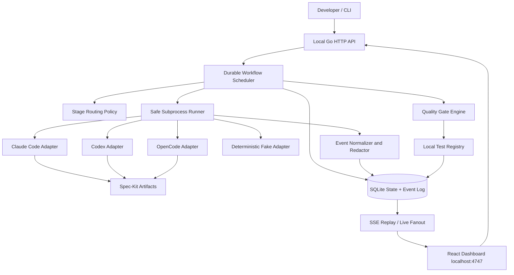

# SpecTide — Complete End-to-End Implementation Blueprint

> **One specification. One execution objective. Multiple verified phases.**  
> **Project type:** Open-source, local-first AI software-development orchestrator  
> **Document:** Product requirements + architecture + implementation backlog + acceptance tests + single-launch bootstrap instructions  
> **Target:** GitHub portfolio-quality v1.0  
> **Prepared:** 21 October 2026  
> **Proposed name:** `SpecTide` (verify GitHub, package, domain, and trademark availability before publication)  
> **Tagline:** *Orchestrate. Implement. Converge.*

## Document navigation

[One-time execution](#0-read-this-first--what-one-time-execution-actually-means) · [Product scope](#2-scope-boundaries-and-delivery-priorities) · [Architecture](#5-architecture) · [Profiles and model routing](#8-stage-routing-profiles-models-and-effort) · [Provider adapters](#9-provider-adapter-contracts--claude-codex-opencode) · [Live monitoring](#11-structured-events-live-sse-and-monitoring) · [Dashboard](#13-dashboard-product-and-ux-specification) · [Quality gates](#15-quality-gates-spec-kit-analyzeconverge-and-strict-completion) · [Implementation roadmap](#17-implementation-execution-roadmap-one-product-spec-many-phases) · [Testing](#18-test-strategy--detailed-scenarios) · [Mac bootstrap](#22-bootstrap-on-your-mac--exact-starting-procedure) · [Final acceptance](#23-final-deliverable-checklist-and-release-acceptance)

---

## 0. READ THIS FIRST — What “One-Time Execution” Actually Means

**Goal:** Give an AI coding agent **one comprehensive product brief** and **one kickoff instruction**, then allow it to create the whole repository in successive, checkpointed development phases. Do **not** ask the user to re-specify the backend, frontend, integrations, tests, and packaging separately.

**Important distinction:** The **official** `/speckit.specify` command creates a specification; it does **not**, by itself, guarantee automatic planning or coding. To reach the user's desired experience, start with `/speckit.specify` once, then instruct the coding agent (or a resumable Spec-Kit workflow) to continue through `/speckit.clarify`, `/speckit.plan`, `/speckit.checklist`, `/speckit.tasks`, `/speckit.analyze`, `/speckit.implement`, `/speckit.converge`, and the necessary verification loops. Depending on the coding agent and context limits, this may involve **multiple internal agent sessions** under **one initial user request**. A paused workflow must be resumable without writing a second feature specification.

**Not a guarantee of zero human input:** A real authentication step, security-sensitive operation, unresolved product ambiguity, unavailable credential, provider outage, or irreducible test failure can require user action. The system must report `BLOCKED` rather than falsely claiming 100% completion. “100%” means all **defined, demonstrable acceptance criteria** passed; it does **not** mean software is mathematically bug-free or has 100% statement coverage.

**Bootstrap paradox:** SpecTide does not yet exist to orchestrate its own construction. Build SpecTide v1 using an **existing** coding agent plus **official GitHub Spec-Kit**. Once working, use SpecTide itself for future features (“dogfooding”). Do not assume the `spectide` CLI exists at the start of this plan.

### 0.1 Immediate user experience after delivery

```bash
# Install a built release of SpecTide (exact installer is implemented in this project)
spectide doctor

cd ~/projects/nusaride
spectide init

# One task request, automatic stage routing
spectide run "Fix concurrent booking duplication and add regression tests"

# Separate terminal OR automatically opened browser
spectide dashboard
# http://127.0.0.1:4747

# Observe/resume/inspect the run
spectide status
spectide resume <run-id>
spectide report <run-id>
```

**Acceptance:** These commands are implemented and documented by v1; they are not claims about currently installed tools.

### 0.2 Single kickoff prompt to use in a coding agent

From the repository root, initialize official Spec-Kit (see §22), attach/reference **this entire Markdown document**, and submit this **single initial instruction**:

> **Build SpecTide v1.0 from the attached `SpecTide_End_to_End_Implementation_Plan.md` as one cohesive, complete project. Treat the document as the authoritative product brief and acceptance contract. Perform `/speckit.specify` only once for the entire product, covering every P0 requirement; do not create separate feature specifications for each module. Continue automatically through the appropriate official Spec-Kit stages: constitution (if missing), clarify, plan, checklist, tasks, analyze, phased implementation, tests, converge, and final validation.**
>
> **Keep progressing through all implementation phases rather than stopping after scaffolding, a mock dashboard, or a single vertical slice. Split actual code execution into bounded chunks for reliability, not into separate user specifications. Maintain durable checkpoints, a task ledger, and test evidence. Re-run analyze when upstream artifacts change; run converge after implementation, execute newly appended convergence tasks, and repeat until clean or a documented blocker/retry limit is reached. Implement working integrations with Claude Code, Codex, and OpenCode, including multiple local profiles, stage-specific models/effort, secure process execution, event normalization, localhost monitoring, CLI, persistent history, and complete tests.**
>
> **Use verified external CLI capabilities rather than invented options. Never bypass account permissions or sandbox safeguards, never commit credentials, and never declare completion without demonstrable passing gates. If an environment lacks authenticated AI providers, implement and test the full flow using realistic deterministic fake-provider fixtures; separately mark live-provider smoke checks as `NOT_RUN` rather than `PASS`. Do not deploy to production or publish to GitHub without explicit approval. At the end, provide a truthful completion report with exact commands, artifacts, passing/failing/skipped checks, and any blockers.**

**Spec-Kit invocation spelling differs by agent:** Claude Code commonly uses `/speckit.specify`, Codex skills can use `$speckit-specify`, and OpenCode command support depends on installed integration. Resolve the correct installed command name by inspection; do not feed a Claude-only slash command blindly to all agents.

### 0.3 Non-negotiable completion contract

- All **P0 features** listed in §4 exist and work end-to-end, rather than mocked-only.
- All three provider adapters have both **fixture-based integration tests** and **live-compatible launch implementations**.
- At least two distinct Claude profiles can be registered without exposing credentials; switching occurs **per stage**.
- Every Spec-Kit phase can have a different `provider`, `profile`, `model`, `effort`, `fallback`, and `execution_policy`.
- The workflow engine can call or orchestrate actual Spec-Kit stages, with **analyze** before implementation and **converge** after implementation; no silent simulation of official commands in real-provider mode.
- Dashboard displays **live** stage, provider/profile, log stream, attempts, quality verdict, and resume state.
- Failed runs persist and recover; **bounded convergence** prevents infinite loops.
- Builds, lint, test suites, documented smoke scenarios, and security gates have verifiable evidence.
- Public repository contains README, architecture/design docs, screenshots (captured from real local UI), license, examples, CI, changelog, and contribution instructions.

---

## 1. Product Vision and Identity

### 1.1 Problem

Existing Spec-Kit development can require manual, repetitive coordination:

1. Run `/speckit.specify`, then `/speckit.plan`, `/speckit.tasks`, and other stages manually.
2. Decide which coding agent, Claude account, model, and effort to use each time.
3. Reconnect context between different CLI programs and their sessions.
4. Notice gaps in specifications and code and manually repeat `/speckit.analyze`, `/speckit.implement`, and `/speckit.converge`.
5. Have no shared, durable localhost view of stage-by-stage execution across providers.

### 1.2 Solution

**SpecTide** is an **opinionated local orchestration layer around GitHub Spec-Kit and existing coding-agent CLIs**, with its own:

- Workflow state machine and quality gates.
- Task classification and manual/automatic/hybrid routing.
- Provider/profile/model/effort adapters.
- Resumable process execution and normalized observability.
- Local API, SQLite history, and React dashboard.
- Provenance, quality evidence, and completion reports.

It **does not** replace Spec-Kit's specifications, templates, commands, or philosophy. It **does not** build an LLM, resell model access, or require cloud backend infrastructure.

### 1.3 Intended users

- Individual developers using one or more of Claude Code, Codex, OpenCode.
- Developers maintaining different accounts or profiles (`claude`, `claude-personal`, work vs personal, provider-specific configs).
- Engineers who care about reliable specs, traceability, quality gates, costs, and monitoring.
- Maintainers who want to dogfood SpecTide inside their own repositories.

### 1.4 Product principles

1. **Local-first**: dashboard binds to loopback; run data stored locally by default.
2. **One prompt, complete lifecycle**: no manual handholding between normal SDD steps.
3. **Explicit control beats hidden magic**: every route, fallback, approval, and result is visible.
4. **Real provider integration**: no fake success states; adapters report unsupported capabilities honestly.
5. **Verification over vanity metrics**: completion must reference test evidence and requirements.
6. **Secure by default**: least privilege, no arbitrary shell from the browser, account and workspace boundaries.
7. **Resumable and idempotent**: process crashes must not corrupt workflow state or duplicate side effects.
8. **Provider neutral**: easy addition of future CLI providers.
9. **Portfolio-quality UX**: beautiful but functional; accessible and responsive.
10. **Respect enterprise boundaries**: never move proprietary repository content to personal profiles without permission.

---

## 2. Scope Boundaries and Delivery Priorities

### P0 — MUST SHIP in v1.0

- Installable `spectide` CLI: `doctor`, `init`, `run`, `dashboard`, `status`, `list`, `logs`, `resume`, `cancel`, `report`, `config`, `profiles`, `models` (minimal but real implementations).
- Go orchestration engine: durable state machine, stage dispatcher, execution engine, bounded retries, structured events.
- Official Spec-Kit detection/initialization and *actual* Spec-Kit stage invocation via installed agent integration; compatible with current upstream CLI conventions.
- Manual/hybrid/automatic routing; stage-specific provider/profile/model/effort configuration with validation.
- Claude Code, Codex, OpenCode process adapters; local wrapper/binary/config-dir profiles.
- One active writer per repository; optional parallel **read-only** reviewer work; no conflicting parallel edits to one worktree.
- Analyze gate, implementation/test loop, convergence gate, and completion evidence.
- Pause at safe boundaries, resume, cancellation, process crash recovery.
- SQLite persistence and a schema migration system.
- Loopback HTTP JSON API + SSE event streaming.
- React dashboard with run list, run detail, workflow timeline, live activity logs, stage configuration, profiles, approvals, final report.
- Provider-independent fake adapter and deterministic scenario suite; testable without paid credentials.
- P0 documentation, local packaging, GitHub Actions tests and release process.

### P1 — Ship after stable v1, not required to claim v1 complete

- Multiple project workspaces in one persistent dashboard.
- Rich visual DAG editor, dynamic graph manipulation, and drag-and-drop workflows.
- Side-by-side Git diffs in browser, detailed cost/usage budgeting charts.
- Full interactive per-tool approval proxy where all providers expose compatible semantics.
- Smart historical model selection based on regression/performance data.
- Concurrent write agents in isolated Git worktrees with merge/review logic.
- Dashboard notifications, desktop notifications, GitHub PR automation.
- Packaged OS-specific installers beyond initial binary/tarball distribution.

### Out of scope for initial build

- Hosted multi-user SaaS; remote browser access or account login system.
- Cloud execution, Kubernetes, containers-as-a-service, remote secret vault.
- A proprietary replacement for Spec-Kit itself.
- Custom LLM training, fine-tuning, payment processing.
- Automatic force-push, production deployment, or remote file sync.
- A promise of universally perfect/bug-free output.

### Definition of v1 vs demo

A polished dashboard with hardcoded sample stages is **not v1**. A CLI runner without a real local event stream is **not v1**. A single provider adapter is **not v1**. v1 requires the working vertical slice across real data layers, **all three** providers, quality gates, and persistence.

---

## 3. Stack — Decided for the First Implementation

| Layer | Choice | Reason |
|---|---|---|
| Main language | Go (stable, supported Go toolchain; pin in `go.mod` and CI) | Cross-platform CLI, subprocess management, low resource use |
| CLI | Cobra | Readable subcommands and help |
| Backend HTTP | Go `net/http` + `chi` router | Minimal operational dependencies |
| DB | SQLite via pure-Go driver (`modernc.org/sqlite` or a maintained equivalent) | Single-binary, no database server or CGO requirement |
| DB migrations | Versioned SQL migration files + migration runner | Recoverable, auditable schema |
| Dashboard | React + TypeScript + Vite | Popular, maintainable frontend |
| Styling | Tailwind CSS + shadcn/ui primitives | Accessible, modern local developer tool |
| Data fetching | TanStack Query; native `EventSource` | HTTP fetch + SSE streaming |
| Flow visualization | React Flow, only where it adds value | Visual workflow status and retries |
| Live protocol | Server-Sent Events (SSE) | Unidirectional progress events; works on localhost |
| State format | SQLite tables + JSON payloads | Queryable history with flexible events |
| Packaging | `go:embed` compiled frontend | One primary runtime binary |
| Frontend testing | Vitest + React Testing Library + Playwright | Unit/component/e2e quality |
| Go testing | `go test`, race detector, fixture integration tests | Engine quality |
| Formatting/lint | `gofmt`, `go vet`, golangci-lint, ESLint, Prettier, `tsc` | Enforce consistent quality |
| CI | GitHub Actions macOS/Linux/Windows | Public portfolio confidence |
| API contract | OpenAPI 3.1 (`docs/openapi.yaml`) | Client contracts, documentation, tests |
| Licensing | MIT, dependencies/license checked | Public contributions |

**Decision:** Go owns scheduling and persisted truth. React renders state but **never** becomes the workflow authority. Provider adapters run local executables; no direct API-key management in SpecTide v1.

**Distribution:** v1 supports macOS and Linux as primary tested platforms and validates Windows functionality in CI where feasible. If a provider CLI has platform-specific behavior, document it; do not fake compatibility. Pin dependency versions during implementation and record provenance.

---

## 4. User Stories and Acceptance Criteria

### US-01: One-prompt feature development (P0)

As a developer, I can run:

```bash
spectide run "Add idempotent Telegram receipt import with AI categorization"
```

**Acceptance:** preflight verifies repo/provider/Spec-Kit; a durable run is created; tasks are executed through workflow stages; user can retrieve report; no manual selection required when defaults valid. The run ends only as `COMPLETED`, `BLOCKED`, `FAILED`, or `CANCELLED` with reasons and evidence.

### US-02: Custom CLI profiles (P0)

As a developer with `claude` and `claude-personal`, I can register both, independently authenticate externally, and assign each to different stages.

**Acceptance:** project doesn't store account cookies/tokens; `specify` uses `claude` profile while `implement` uses `claude-personal`, and logs distinctly label each. Security policy blocks forbidden work→personal transfer.

### US-03: Manual model and effort per stage (P0)

As a developer, I can specify different providers, profiles, models, efforts and fallback profiles for `specify`, `clarify`, `plan`, `checklist`, `tasks`, `analyze`, `implement`, `converge`, `final_review`.

**Acceptance:** dashboard and CLI show resolved route before executing; invalid model/effort combination fails preflight, or is downgraded only if user explicitly opts into fallback. No silently ignored config.

### US-04: Hybrid and automatic routing (P0)

As a developer, I can choose `manual`, `hybrid`, or `automatic` routing modes.

**Acceptance:** manual always honors explicit routes; hybrid preserves overrides and fills unspecified stages using documented defaults; automatic uses a deterministic policy based on task kind/complexity/risk (optional AI classifier is non-authoritative). Every decision is recorded with explanation.

### US-05: Real Spec-Kit analysis (P0)

As a developer, I expect the orchestrator to run installed `/speckit.analyze` (or agent-native equivalent) before implementation and to remediate real artifacts.

**Acceptance:** any blocking inconsistency sends the workflow to the owning artifact stage; `analyze` is read-only; the orchestration layer causes authorized remediation, then re-analyzes. If command missing: `BLOCKED`, not fabricated success.

### US-06: Converge-to-completion (P0)

As a developer, I want missing work appended by `/speckit.converge` and implemented, with a bounded loop.

**Acceptance:** after implementation and tests, converge runs; when tasks appended, loop back to `implement` and tests; final convergence reports `Converged` and quality gate checks pass. No progress within defined bounds produces `BLOCKED` with clear gap report.

### US-07: Local real-time monitoring (P0)

As a developer, I can open `http://127.0.0.1:4747` and see current stage, provider, profile, model, effort, attempts, duration, logs and quality results without refreshing.

**Acceptance:** events appear as adapter streams are consumed; reconnect resumes from last event cursor; two viewers receive consistent state; reload recovers snapshot from DB.

### US-08: Crash recovery (P0)

As a developer, I can restart the daemon/browser after unexpected shutdown without losing accurate state.

**Acceptance:** stage transitions persisted transactionally; orphaned running processes resolved to `INTERRUPTED`; resume starts only safe/restartable work; no duplicate run creation.

### US-09: Safety and approvals (P0)

As a developer, I approve any dangerous operation before it runs, and never grant one profile access to a forbidden repository.

**Acceptance:** predefined approval gates, repository-to-profile allowlist, sensitive-command policies, loopback-only server, secret redaction, secure cancellation and failure reporting.

### US-10: Portfolio distribution (P0)

As another developer, I can clone, build, test, start the daemon, run fixture demo, and navigate useful docs without buying subscriptions.

**Acceptance:** `make build`, `make test`, `make demo` and CI execute; screenshots come from real UI; releases include binaries and checksums; README has installation and security notes.

### US-11: Provider outage and unsupported capability (P0)

As a developer, I receive intelligible errors when a provider is offline, lacks auth, lacks effort support, or rate-limits.

**Acceptance:** typed error codes; no silent switch to an unapproved account; retries are bounded; dashboard shows corrective guidance and resumes correctly.

---

## 5. Architecture



### 5.1 Core subsystem boundaries

1. **CLI / API:** validate commands, parse options, expose run operations and snapshots.
2. **Orchestrator:** own run state, stage DAG, retries, approvals, resume and cancellation.
3. **Spec-Kit bridge:** discover installed `specify`, detect/init project integration, create prompt envelopes for official stages, read artifacts, watch tracked file changes, parse reports conservatively.
4. **Routing policy:** resolve per-stage provider/profile/model/effort; enforce repo and credential access rules.
5. **Agent adapters:** launch the correct CLI with supported args; parse machine-readable output into typed normalized events.
6. **Workspace manager:** verify Git checkout, ensure one writer, artifact snapshots and diffs.
7. **Quality/verifier:** define acceptance gates, structured test execution, evidence capture and final verdict.
8. **Persistence/event bus:** canonical snapshot plus append-only event journal; recover and replay.
9. **Dashboard:** render observed state and approved user actions. No local shell execution from UI.

### 5.2 One scheduler, not two competing schedulers

Official Spec-Kit has a workflow engine (`specify workflow run/resume/status`) and orchestration primitives. **SpecTide v1 owns scheduling** for its normal runs and invokes **official individual Spec-Kit commands** via provider adapters, because it needs provider-specific profiles, reasoning effort, live events, safety, and convergence repair decisions. Do **not** concurrently run the upstream `speckit` workflow and the custom SpecTide run in the same worktree: they would compete over files and state.

Still support upstream workflow tools as an **optional advanced compatibility mode** in later versions: parse upstream workflow JSON/status, run external workflows deliberately, and prohibit duplicate scheduling. Document which control plane owns each run.

### 5.3 Process lifecycle

- Before running: workspace canonicalized, profile validated, repo lock acquired, config frozen into run snapshot, event sequence initialized.
- During run: spawn process using argument vectors, restricted env and working directory; consume stdout/stderr incrementally and parse event frames without unbounded buffering.
- On stage completion: persist result + evidence + next stage atomically; release process handles.
- On recover: reconcile DB state with known OS processes; never guess stage success; mark ambiguous cases `INTERRUPTED` and require verified resume path.
- On cancel: mark cancellation intent, send graceful termination, deadline, forced kill if necessary, preserve evidence and release lock.

### 5.4 Data flow and context handoff

Shared Git worktree + immutable stage snapshot files are the default context transport. Each stage receives:

- Task and run identifiers, original user prompt, project root, branch and HEAD hash.
- The stage-specific **real** Spec-Kit command invocation and expected artifacts.
- Prior `spec.md`, `plan.md`, `tasks.md`, checklists and prior verifier outputs, selectively loaded to avoid context bloat.
- Security/permission policy, clear no-secret instructions, acceptance criteria and current retry number.
- Stage-specific model/profile/effort and max usage budget.

Store an immutable manifest of paths and hashes before/after each stage, plus Git diff summary; never depend solely on one provider's chat session history. When later stages use a different provider, replay the **artifacts and concise handoff manifest**, not hidden thought transcripts.

### 5.5 Deployment modes

- **Foreground:** `spectide run ...` uses embedded daemon/core and prints events. Dashboard can attach to a running local server.
- **Local daemon:** `spectide serve --host 127.0.0.1 --port 4747`; CLI calls daemon API when available. If unavailable, `spectide run` can start ephemeral loopback server or fall back to foreground CLI with clear message.
- **Embedded web:** production Go binary serves React static assets (`go:embed`) and API under one origin.
- No mandatory cloud infrastructure.

---

## 6. Repository Layout and Packages

```text
spectide/
├── README.md
├── LICENSE
├── CHANGELOG.md
├── CONTRIBUTING.md
├── SECURITY.md
├── CODE_OF_CONDUCT.md
├── .editorconfig
├── .gitignore
├── .github/
│   ├── workflows/{ci,release,security}.yml
│   ├── ISSUE_TEMPLATE/
│   └── pull_request_template.md
├── cmd/spectide/main.go
├── internal/
│   ├── app/                 # dependency wiring, lifecycle
│   ├── cli/                 # Cobra commands
│   ├── config/              # TOML/YAML loading, validation, migrations
│   ├── model/               # typed domain structures and enums
│   ├── workflow/            # stage graph, FSM, scheduling, retry
│   ├── routing/             # manual/auto/hybrid routing and policy
│   ├── adapters/
│   │   ├── adapter.go       # interfaces + normalized errors
│   │   ├── claude/
│   │   ├── codex/
│   │   ├── opencode/
│   │   └── fake/
│   ├── runner/              # subprocess, timeouts, signal handling
│   ├── speckit/             # CLI detection, command mapping, artifacts
│   ├── workspace/           # repo locks, snapshots, safety
│   ├── quality/             # gate evaluation, test registry, reports
│   ├── store/               # SQLite repositories + transactions
│   ├── events/              # normalized events, redaction, fanout
│   ├── api/                 # handlers, middleware, SSE
│   ├── security/            # origin/CSRF/repo/profile rules
│   └── webassets/           # embedded frontend artifact
├── migrations/             # versioned SQL migrations
├── web/
│   ├── package.json
│   ├── pnpm-lock.yaml
│   ├── vite.config.ts
│   ├── src/
│   │   ├── app/
│   │   ├── components/
│   │   ├── pages/{Overview,RunDetail,Profiles,Settings}.tsx
│   │   ├── features/{runs,workflow,logs,approvals,profiles,reports}/
│   │   ├── hooks/
│   │   ├── lib/api.ts
│   │   └── types/
│   ├── tests/
│   └── e2e/
├── configs/
│   ├── spectide.example.yaml
│   └── workflow.default.yaml
├── docs/
│   ├── architecture.md
│   ├── user-guide.md
│   ├── configuration.md
│   ├── provider-adapters.md
│   ├── security-model.md
│   ├── recovery.md
│   ├── troubleshooting.md
│   ├── openapi.yaml
│   ├── adr/
│   └── screenshots/
├── examples/
│   ├── familyflow.yaml
│   ├── cross-profile.yaml
│   └── fake-provider-demo/
├── testdata/
│   ├── fixtures/{claude,codex,opencode,speckit}/
│   └── test-repository/
├── scripts/
│   ├── build.sh
│   ├── smoke.sh
│   └── demo.sh
├── Makefile
├── go.mod
└── go.sum
```

**Repository generation guardrail:** do not add unnecessary services, microservices, queues or external databases. Keep packages coherent; don't create dozens of empty placeholders. Code must compile and each used module must have tests.

---
## 7. Canonical Domain Model and State Machine

### 7.1 Entities

| Entity | Key fields | Rules |
|---|---|---|
| `Project` | id, display_name, canonical_path, allowed_profiles, created_at | Canonical, local path; uniqueness across aliases/symlinks |
| `Run` | id (ULID/UUIDv7), project_id, original_prompt, config_snapshot, workflow_version, state, start/end | Immutable intent and routing snapshot; mutable lifecycle fields |
| `StageAttempt` | id, run_id, stage_key, attempt, state, provider, profile, model, effort, started/ended, exit_code | Each retry gets a new attempt; no overwrite of historical failure |
| `AgentSession` | id, attempt_id, provider_session_id, pid, process_start_fingerprint, status | Provider IDs are not global; include profile namespace |
| `Event` | seq, run_id, attempt_id?, kind, timestamp, severity, redacted_json | Per-run monotonic sequence; append-only; replay cursor |
| `Artifact` | id, run_id, stage_key, relative_path, sha256, git_revision?, kind | Paths confined to workspace; no external secret paths |
| `QualityGate` | id, run_id, gate_type, verdict, evidence_refs, evaluated_at | Typed `PASS/FAIL/BLOCKED/NOT_RUN`; no inferred pass |
| `Approval` | id, run_id, action, rationale, status, requested/decided_at, actor | Pending actions fail closed; user must decide |
| `Profile` | id, provider, executable, config_dir, env_ref, scope, allowed_projects | Never store API tokens in plaintext DB or YAML |
| `RoutingDecision` | stage_key, resolved_route, policy_version, inputs, explanation | Auditability and deterministic reproduction |
| `TestExecution` | id, run_id, command_key, exit_code, duration, output_ref | Structured quality evidence |
| `Checkpoint` | run_id, stage_index, cursor, config_hash, artifact_manifest_hash, created_at | Resume must validate workspace drift |
| `RepoLock` | canonical_workspace, holder_run_id, lease_generation, heartbeat | One active workspace writer, stale locks recover safely |

### 7.2 Run states

```text
CREATED
   -> PREFLIGHT
   -> RUNNING
        -> WAITING_APPROVAL -> RUNNING
        -> PAUSE_REQUESTED -> PAUSED -> RUNNING
        -> INTERRUPTED -> RECOVERING -> RUNNING
        -> BLOCKED
        -> FAILED
        -> CANCEL_REQUESTED -> CANCELLED
        -> COMPLETED
```

Explicitly distinguish **process exit** from **stage semantic outcome**. Exit code 0 with missing/invalid evidence is not equivalent to an accepted stage. A failed build cannot be overridden by a “looks good” model response.

### 7.3 Stage states

`PENDING`, `READY`, `RUNNING`, `SUCCEEDED`, `FAILED`, `SKIPPED_WITH_REASON`, `PAUSED`, `INTERRUPTED`, `CANCELLED`.

Stage transitions must be checked centrally; invalid transitions reject with typed errors. Persist changes and the corresponding event in one DB transaction. Prefer **append-first + materialized snapshot in same transaction**. UI derives status from DB, never reconstructs canonical truth from provider prose.

### 7.4 Canonical stages and owners

| Stage key | Official intent | Output / gate |
|---|---|---|
| `constitution` | `/speckit.constitution` | Project principles (once if absent; never overwrite unexpectedly) |
| `specify` | `/speckit.specify` | Single product `spec.md` and related artifacts |
| `clarify` | `/speckit.clarify` | Ambiguity resolution or explicit nonblocking assumption log |
| `plan` | `/speckit.plan` | `plan.md`, research/data model/contracts as needed |
| `checklist` | `/speckit.checklist` | Requirements quality review; human approval semantics preserved |
| `tasks` | `/speckit.tasks` | Dependency-ordered `tasks.md` with acceptance IDs |
| `analyze` | `/speckit.analyze` | Consistency report, zero **blocking** gaps |
| `implement` | `/speckit.implement` | Code, tests, completed task markers |
| `tests` | Local test registry (not Spec-Kit command) | Build/lint/unit/integration/e2e results |
| `converge` | `/speckit.converge` | **Converged** or appended convergence tasks |
| `final_review` | Independent audit + code/requirements checks | Cross-provider review + acceptance ledger |
| `report` | SpecTide native | Final signed/evidence-linked run summary |

**Special handling:** `analyze` is read-only; if it finds a problem, route remediation to the earlier artifact-owning stage and run analyze again. `converge` is append-only to `tasks.md`, and should run only after an implementation attempt on the current tasks. The orchestrator (not the converge command) implements appended tasks.

### 7.5 Stage transition algorithm (normative pseudocode)

```text
create_run(prompt, validated_config, project)
acquire_workspace_write_lock(project)
preflight(project, profiles, local_clis, speckit)

if missing_constitution: execute_stage("constitution")
execute_stage("specify")  # ONCE for whole product/task
execute_stage("clarify")  # if required by ambiguity policy
execute_stage("plan")
execute_stage("checklist")
execute_stage("tasks")

analysis_round = 0
while true:
  result = execute_stage("analyze", READ_ONLY)
  if result.blocking_count == 0 and evidence_valid(result): break
  if analysis_round >= max_analyze_rounds: BLOCKED("analysis did not stabilize")
  route_fixes_to_owning_artifact_stage(result)
  repeat_only_necessary_upstream_stage(s)
  analysis_round++

convergence_round = 0
last_task_digest = sha256(tasks_md)
while true:
  execute_stage("implement", WRITE_ALLOWED)
  test_result = run_required_test_suite()
  if not test_result.passed:
      if not can_repair_within_limits(): BLOCKED("tests not passing")
      route_test_fix_to_implement()
      continue

  convergence = execute_stage("converge", APPEND_TASKS_ONLY)
  if convergence.is_converged and verification_evidence_complete:
      break
  if convergence.appended_tasks:
      assert tasks_md_gained_only_new_convergence_tasks()
      assert no_existing_completed_tasks_rewritten()
  else:
      BLOCKED("invalid/ambiguous converge output")

  if convergence_round >= max_converge_rounds:
      BLOCKED("non-converging workflow")
  if sha256(tasks_md) == last_task_digest:
      BLOCKED("convergence no-progress")
  last_task_digest = sha256(tasks_md)
  convergence_round++

run_independent_final_review()
run_final_critical_tests_after_last_code_change()
ensure_no_unresolved_blocking_quality_gate()
mark_run_COMPLETED_with_evidence()
release_workspace_lock()
```

**Refinement:** failed tests that generate code changes must lead to **re-running convergence after passing tests**, never skipping converge. A final review that detects an implementation gap must route back to authorized fix, then re-test and re-converge. If upstream requirements legitimately change, rerun analyze; avoid specifying the whole product again. The state machine must support repeated visits to a stage without mutating already accepted immutable historical attempts.

### 7.6 Safe idempotency and progress tracking

- Every stage attempt has deterministic idempotency key `(run_id, stage_key, logical_iteration, attempt_number)`.
- Persist attempt `RUNNING` + command manifest **before spawn**; record PID and start fingerprint after spawn.
- After restart, identify whether process is alive; do not attach based on PID alone (PID reuse).
- If an attempt's outcome is unknown, rerun read-only stages; for mutating stages compare artifact manifests/Git diff, inspect tasks, then require confirmation or safe re-entry.
- Checkpoint after every successful stage and before any approval.
- Lock lease must protect overlapping daemon/process starts; use database transaction/OS lock instead of heartbeat alone.

---

## 8. Stage Routing, Profiles, Models and Effort

### 8.1 Configuration levels and precedence

```text
Built-in safe defaults
  < Global user config (~/.config/spectide/config.yaml)
  < Project config (<repo>/.spectide/config.yaml)
  < Named workflow preset
  < CLI per-run override
  < Interactive dashboard change BEFORE next stage
```

Sensitive managed security policies are an upper bound: project, CLI and dashboard must **not** override deny rules or host/account restrictions. Freeze effective configuration at run start for reproducibility; stage changes after start require explicit update, audit event, and rerouting only at safe boundaries.

### 8.2 Full example config (proposed SpecTide schema, **not upstream Spec-Kit YAML**)

```yaml
schema_version: 1
project:
  name: spectide
  workspace: .

server:
  host: 127.0.0.1
  port: 4747
  open_browser: false

workflow:
  mode: full_sdd
  routing_mode: hybrid       # manual | hybrid | automatic
  max_analyze_rounds: 3
  max_converge_rounds: 5
  max_test_repair_attempts: 4
  require_tests: true
  require_converged: true
  require_final_review: true
  require_clean_checklists: true
  on_blocker: pause           # pause and surface actionable status
  approval_policy: sensitive_only

profiles:
  claude-work:
    provider: claude
    executable: claude
    config_dir: ~/.claude-work
    allowed_projects: [personal-public]
    max_concurrent: 1
  claude-personal:
    provider: claude
    executable: claude-personal  # must be a binary/script, not merely shell alias
    # or: executable: claude; config_dir: ~/.claude-personal
    allowed_projects: [personal-public]
    max_concurrent: 1
  codex-main:
    provider: codex
    executable: codex
    # optional provider-specific named config profile / CODEX_HOME
    allowed_projects: [personal-public]
  opencode-main:
    provider: opencode
    executable: opencode
    # optional OPENCODE_CONFIG / OPENCODE_CONFIG_DIR
    allowed_projects: [personal-public]

routing:
  defaults:
    profile: claude-personal
    model: sonnet
    effort: medium
    timeout_minutes: 45
  stages:
    constitution: {profile: claude-work, model: sonnet, effort: high}
    specify:      {profile: claude-work, model: sonnet, effort: high}
    clarify:      {profile: claude-work, model: sonnet, effort: medium}
    plan:         {profile: claude-work, model: opus, effort: high}
    checklist:    {profile: claude-work, model: sonnet, effort: medium}
    tasks:        {profile: claude-work, model: sonnet, effort: medium}
    analyze:      {profile: codex-main, model: auto, effort: high}
    implement:
      profile: claude-personal
      model: sonnet
      effort: high
      fallback:
        - {profile: opencode-main, model: auto, effort: medium}
      timeout_minutes: 90
    converge:     {profile: claude-work, model: opus, effort: high}
    final_review: {profile: codex-main, model: auto, effort: high}

quality:
  test_commands:
    - {key: backend, argv: [go, test, ./...], timeout_minutes: 10}
    - {key: web_typecheck, argv: [pnpm, --dir, web, typecheck], timeout_minutes: 10}
    - {key: web_test, argv: [pnpm, --dir, web, test, --run], timeout_minutes: 10}
  require:
    - analyze_clean
    - converged
    - all_p0_acceptance_evidenced
    - zero_failed_required_tests
    - no_critical_security_findings

security:
  allowed_workspaces: [~/projects]
  profile_data_boundary: personal-public
  allow_cross_profile: true
  require_approval_for_profile_boundary_change: true
  forbid_unrestricted_host_execution: true
  redact_logs: true
  allow_external_bind: false

observability:
  retention_days: 30
  max_stored_log_megabytes_per_run: 100
  live_event_ring_size: 2048
```

**Notes:** Real adapter capability discovery may reject an alias or effort level (for example, a specific Codex/OpenCode model or variant). `auto` means use configured provider default **after verification**, not literally pass `--model auto`. `timeout_minutes` is an orchestrator timeout, not a guaranteed provider argument. Values are examples; users must choose the profiles they are authorized to use.

### 8.3 Provider/profile/model/effort mapping

| Field | Meaning | Enforcement |
|---|---|---|
| Provider | Claude Code, Codex, OpenCode | Adapter selection |
| Profile | Authentication and settings environment/CLI executable | Distinct namespace, safe executable resolution |
| Model | Provider-specific model ID or recognized alias | Detect/validate at runtime |
| Effort | Provider-specific reasoning level or variant | Map only documented/supported values |
| Fallback | Alternate allowed route when unavailable/failed | Explicit policy, permission boundary check |
| Execution policy | Sandbox, allowed tools, timeouts, approvals | Cannot bypass security ceiling |
| Cost limits | Best-effort cap based on available usage reporting | Never claim reliable hard billing caps |

### 8.4 Modes

**Manual:** every stage must have explicit valid route (or deliberately specified default); never change it without request.

**Hybrid (default):** preserve explicit overrides; fill missing fields using rules; escalation permitted within an **allowlisted fallback chain**.

**Automatic:** classify `bug/feature/refactor/architecture`, complexity `simple/medium/high`, and sensitivity `low/medium/high`; resolve route using safe policies. User can preview effective routing before launch.

Recommended classifier should initially be **deterministic** (number of touched modules, schema changes, concurrency, money movement, security, deployment, external integrations, test breadth). Model-based advice may enrich confidence but cannot downgrade sensitive-task gates.

Example rules:

- Payment processing, financial state, auth, concurrency, migrations => `HIGH_RISK` and full SDD regardless of size.
- Local docs/typos => focused workflow allowed, but only if user didn't force full SDD.
- Novel architecture or unclear acceptance criteria => full clarify and plan.
- Model failure or provider rate limit => fallback only when explicit allowed; keep provenance.
- One stage's failure must never mutate unrelated stage routes without audit.

### 8.5 CLI operations for routing and profiles

```bash
spectide profiles add claude-work --provider claude --executable claude --config-dir ~/.claude-work
spectide profiles add claude-personal --provider claude --executable claude-personal
spectide profiles add codex-main --provider codex --executable codex
spectide profiles add opencode-main --provider opencode --executable opencode

spectide profiles list
spectide profiles doctor --all
spectide models list --profile claude-personal
spectide config show --resolved

spectide config set routing.stages.specify.profile claude-work
spectide config set routing.stages.specify.model sonnet
spectide config set routing.stages.specify.effort high
spectide config set routing.stages.implement.profile claude-personal
spectide config set routing.stages.implement.effort medium

spectide run "Build a dashboard" --routing hybrid --dry-run
spectide run "Build a dashboard" --implement-profile claude-personal --implement-effort high
```

`--dry-run` must print all proposed commands, routes, paths, permission ceilings and resource budgets **without launching agents or writing to the repo** (except optional user-approved run-plan export).

### 8.6 Cross-profile security model

- A profile is **not** assumed to be a separate account merely because its command has a different name; validate effective executable/config and display auth verification state.
- If a `claude-personal` name is only an alias/function from interactive Zsh, `exec` does not see it. Accept a real executable/script, or allow a standard `claude` executable plus `CLAUDE_CONFIG_DIR`.
- **Do not launch interactive login from hidden background processes.** Ask user to authenticate each profile in their own terminal.
- For corporate/private projects, profile switching that transmits code to a personal/third-party account must default-deny and require explicit organizational authorization (not just user click-through if prohibited by policy).
- Restrict credentials to their own provider process; scrub inherited unrelated env variables; never copy auth material between profiles.
- Do not infer profile rate-limit exhaustion by reading private credential files.

---

## 9. Provider Adapter Contracts — Claude, Codex, OpenCode

### 9.1 Shared Go interfaces

```go
type ProviderName string

type StageRequest struct {
    RunID string
    AttemptID string
    ProjectRoot string
    Stage string
    Prompt string
    Profile ResolvedProfile
    Model string
    Effort string
    Timeout time.Duration
    Permission ExecutionPolicy
    Artifacts []ArtifactRef
}

type Adapter interface {
    Name() ProviderName
    Probe(ctx context.Context, profile ResolvedProfile) (Capabilities, error)
    BuildInvocation(req StageRequest) (Invocation, error)
    NormalizeEvent(raw []byte, stream StreamKind) ([]AgentEvent, error)
    InterpretResult(ctx context.Context, req StageRequest, execution ExecutionResult) (StageEvidence, error)
}

type Invocation struct {
    Binary string
    Args []string
    Env []string
    Dir string
    Stdin []byte
}
```

**No `sh -c` with arbitrary provider/profile input**; use explicit `exec.CommandContext(binary, args...)`. Resolve command name against a trusted path or allowlisted binary. Detect unsupported flags via version/capability negotiation.

### 9.2 Claude Code adapter

**Documented primitives:** `claude -p`, `--model`, `--effort`, `--output-format stream-json`, `--verbose`, optional `--include-partial-messages`; `CLAUDE_CONFIG_DIR` allows alternative settings/session directory. Values supported vary by Claude model and installed CLI version.

Representative invocation (validate locally before production):

```bash
CLAUDE_CONFIG_DIR="$HOME/.claude-work" \
claude -p \
  --model sonnet \
  --effort high \
  --output-format stream-json \
  --verbose \
  "<resolved stage prompt>"
```

Implementation details:

- Support a wrapper executable called `claude-personal` as an alternate local binary **when resolvable**; do not spawn a shell to expand aliases.
- Call `claude auth status` under the resolved profile **if supported**; report logged in/not logged in, never read auth tokens directly.
- Set a safe `--permission-mode` / tool policy appropriate to stage: analysis/read-only stages must not be allowed to write. Do not use `bypassPermissions` by default.
- Capture structured line-delimited events, including progress, tool boundaries, final result; hide sensitive content; never expose raw private thinking in UI.
- Use provider-specific session IDs only for optional safe continuation, not as canonical workflow state.
- Test partial JSON chunks, malformed frames, user cancellation, 0/1 exit codes, auth errors, and rate-limit messages.

### 9.3 Codex CLI adapter

**Documented primitives:** `codex exec --json`, `--model`, `--profile` where supported, `-c/--config` overrides, `--cd`, and workspace permission/sandbox options. Codex's reasoning configuration depends on CLI version/model; commonly exposed as `model_reasoning_effort`, but verify supported values before use.

Representative invocation (verify exact flags with the installed CLI):

```bash
codex exec --json \
  --model "<selected-model>" \
  --config 'model_reasoning_effort="high"' \
  --sandbox workspace-write \
  --cd "/absolute/project" \
  "<resolved stage prompt>"
```

Read-only review tasks use `--sandbox read-only`. Never use `--dangerously-bypass-approvals-and-sandbox` by default. Implement optional `CODEX_HOME` and named profile support only after verifying installed CLI behavior. Parse JSONL event types and recover gracefully when a newer version adds unknown fields.

### 9.4 OpenCode adapter

**Documented primitives:** `opencode run`, `--model provider/model`, `--format json`, `--variant` for model-specific reasoning, optional `--dir`; `OPENCODE_CONFIG` and `OPENCODE_CONFIG_DIR` support custom config paths. Native OpenCode server API/SSE is optional, not required for v1 if CLI JSON streaming is reliable.

Representative invocation (verify variant exists for model):

```bash
OPENCODE_CONFIG="$HOME/.config/opencode/my-profile.json" \
opencode run --format json \
  --model "<provider>/<model>" \
  --variant "<supported-variant>" \
  --dir "/absolute/project" \
  "<resolved stage prompt>"
```

Never assume every model has `medium/high` variants. Probe or map variant capabilities and fall back **only** when policy permits. Support OpenCode auth set up externally; don't store its tokens. Prevent auto-sharing provider sessions or exposing them through server mode unless user explicitly opts in.

### 9.5 Fake adapter (required)

Implement a test-only adapter with scripted stages, deterministic delays, emitted JSON events, outputs, injected failures, appended convergence tasks, rate-limit simulation and cancellation. It must run without any paid account.

**Important:** `fake` must be visually and programmatically labeled `SIMULATED`. Fake-adapter completion cannot be presented as a live-provider integration pass. It exists for reproducibility, CI, demo and failure testing.

### 9.6 Capability probe and compatibility matrix

At startup and in `spectide doctor`, gather:

```json
{
  "provider": "claude",
  "profile": "claude-personal",
  "executable_found": true,
  "version": "detected-at-runtime",
  "authenticated": "yes|no|unknown",
  "streaming_events": true,
  "model_override": true,
  "effort_override": "supported|partial|unsupported",
  "sandbox_policy": "supported|partial|unsupported",
  "native_resume": "supported|unsupported",
  "warnings": []
}
```

Do not manufacture a complete model catalog. Probe provider CLI when possible; where unavailable, allow a custom model string but mark its compatibility unverified and gate launch. Keep provider-version fixture tests, and show a compatibility warning when versions change.

### 9.7 Spec-Kit command translation

Spec-Kit commands are **agent instructions/skills**, not standalone `specify` shell subcommands. The bridge must:

1. Verify Spec-Kit project initialization and detect installed integration files.
2. Map **canonical stages** to installed invocation pattern for the *selected target agent* (e.g. Claude `/speckit.specify`; Codex `$speckit-specify`; OpenCode pattern confirmed by installed integration).
3. Where the provider's native command files are absent, prepare supported integration via official `specify init` or official integration update, **after backup/approval**; never silently overwrite another agent's config.
4. If stage runs on a different provider than init agent, ensure that provider's Spec-Kit skill/command files are installed and discoverable. Test multi-provider initialization in a fixture repo; keep a manifest of generated files.
5. Distinguish command acceptance from actual artifact production: inspect expected files and semantic output.
6. Version-pin or document tested Spec-Kit release and expose unsupported-command errors clearly.
7. Ensure separate provider sessions still share the same branch/spec directory; branch naming may be affected by Spec-Kit commands. Inspect actual artifact paths rather than hardcode `specs/001-*`.

A robust bridge may use **official Spec-Kit templates and command instructions through provider adapters** for stage execution while employing `specify` CLI for init/diagnostics. It must never merely pretend to have invoked a missing official command.

### 9.8 Failure classification

Implement normalized errors:

`EXECUTABLE_NOT_FOUND`, `NOT_AUTHENTICATED`, `MODEL_UNSUPPORTED`, `EFFORT_UNSUPPORTED`, `PERMISSION_DENIED`, `PROFILE_NOT_ALLOWED`, `CLI_VERSION_INCOMPATIBLE`, `RATE_LIMITED`, `NETWORK_UNAVAILABLE`, `PROVIDER_TIMEOUT`, `MALFORMED_EVENT`, `STAGE_EVIDENCE_MISSING`, `CHECKLIST_UNAPPROVED`, `ANALYSIS_BLOCKING`, `CONVERGENCE_STALLED`, `TESTS_FAILED`, `WORKSPACE_DIRTY_OR_DRIFTED`, `RUN_CANCELLED`, `DB_CORRUPTION`.

Retry transient errors with exponential backoff + jitter; **never** retry permission denial, unsupported model, wrong profile, or unauthorized account routing silently. Cap total retries and time.

---
## 10. SQLite Schema and Persistence Contract

### 10.1 Migration strategy

- Store DB by default at `~/.local/share/spectide/spectide.db` (XDG Base Directory-compliant; use proper macOS platform data dir when configured).
- SQLite `WAL` mode, foreign keys ON, bounded busy timeout; one writer pattern and regular transactions.
- Migrations have sequential schema versions and transactional upgrades; maintain `schema_migrations` table, backup before destructive migration.
- Avoid storing secrets, whole git repository contents, and unredacted process environment.
- Store large raw event streams in capped local files if necessary; DB stores redacted normalized events plus file references with allowed paths.
- SQLite reads must work while one run appends events; dashboard updates should not block workflow execution.

### 10.2 Minimum database tables

```sql
-- Illustrative DDL; adjust constraints/indexes via migration tests.
CREATE TABLE projects (
  id TEXT PRIMARY KEY,
  display_name TEXT NOT NULL,
  canonical_path TEXT NOT NULL UNIQUE,
  data_boundary TEXT NOT NULL DEFAULT 'personal-public',
  created_at TEXT NOT NULL
);

CREATE TABLE runs (
  id TEXT PRIMARY KEY,
  project_id TEXT NOT NULL REFERENCES projects(id),
  original_prompt TEXT NOT NULL,
  state TEXT NOT NULL,
  workflow_version TEXT NOT NULL,
  config_json TEXT NOT NULL,
  created_at TEXT NOT NULL,
  started_at TEXT,
  ended_at TEXT,
  last_checkpoint_id TEXT
);

CREATE TABLE stage_attempts (
  id TEXT PRIMARY KEY,
  run_id TEXT NOT NULL REFERENCES runs(id),
  stage_key TEXT NOT NULL,
  iteration INTEGER NOT NULL DEFAULT 0,
  attempt INTEGER NOT NULL DEFAULT 1,
  state TEXT NOT NULL,
  profile_id TEXT NOT NULL,
  provider TEXT NOT NULL,
  model TEXT,
  effort TEXT,
  pid INTEGER,
  process_fingerprint TEXT,
  exit_code INTEGER,
  started_at TEXT,
  ended_at TEXT,
  result_json TEXT,
  UNIQUE(run_id, stage_key, iteration, attempt)
);

CREATE TABLE events (
  run_id TEXT NOT NULL REFERENCES runs(id),
  seq INTEGER NOT NULL,
  stage_attempt_id TEXT,
  ts TEXT NOT NULL,
  kind TEXT NOT NULL,
  severity TEXT NOT NULL,
  payload_json TEXT NOT NULL,
  PRIMARY KEY (run_id, seq)
);
CREATE INDEX events_stage_idx ON events(stage_attempt_id, seq);

CREATE TABLE approvals (
  id TEXT PRIMARY KEY,
  run_id TEXT NOT NULL REFERENCES runs(id),
  action TEXT NOT NULL,
  reason TEXT NOT NULL,
  status TEXT NOT NULL,
  requested_at TEXT NOT NULL,
  resolved_at TEXT,
  resolution_note TEXT
);

CREATE TABLE quality_gates (
  id TEXT PRIMARY KEY,
  run_id TEXT NOT NULL REFERENCES runs(id),
  gate_key TEXT NOT NULL,
  verdict TEXT NOT NULL,
  evidence_json TEXT NOT NULL,
  evaluated_at TEXT NOT NULL
);

CREATE TABLE artifacts (
  id TEXT PRIMARY KEY,
  run_id TEXT NOT NULL REFERENCES runs(id),
  stage_attempt_id TEXT,
  relative_path TEXT NOT NULL,
  sha256 TEXT NOT NULL,
  artifact_kind TEXT NOT NULL,
  observed_at TEXT NOT NULL
);

CREATE TABLE checkpoints (
  id TEXT PRIMARY KEY,
  run_id TEXT NOT NULL REFERENCES runs(id),
  workflow_state_json TEXT NOT NULL,
  artifact_manifest_json TEXT NOT NULL,
  created_at TEXT NOT NULL
);

CREATE TABLE workspace_locks (
  canonical_path TEXT PRIMARY KEY,
  run_id TEXT NOT NULL REFERENCES runs(id),
  generation INTEGER NOT NULL,
  heartbeat_at TEXT NOT NULL
);
```

Additional tables may include `profile_metadata`, `routing_decisions`, `test_executions`, `agent_sessions`, and `schema_migrations`. Add indexes for recent-run list and time-window views. All request handlers must use parameterized SQL.

### 10.3 Required DB invariants

- Each event `(run_id, seq)` unique and monotonic.
- An active stage must belong to an active run; finished attempts are immutable.
- Only one active **writer** per canonical workspace; stale lock takeover requires atomic compare-and-swap.
- Run transition + event insert within one DB transaction.
- Resume cannot overwrite previous quality verdict evidence.
- Historical run configuration immutable, even after global config changes.
- Clock times stored in UTC RFC 3339; UI localizes timestamps.
- Logs must not contain serialized auth environment.

### 10.4 State retention and export

- Preserve run summary and quality evidence by default.
- Rotate/delete raw logs by configurable age/size, with clear warnings when history is incomplete.
- Provide `spectide report <id> --format json|markdown` with sanitized, portable output.
- Provide `spectide data backup`/`restore` (local file, with schema compatibility checks) if feasible in P0; at minimum backup is documented and migration-tested.

---

## 11. Structured Events, Live SSE and Monitoring

### 11.1 Canonical event envelope

```json
{
  "schema_version": 1,
  "run_id": "01example",
  "seq": 148,
  "timestamp": "2026-10-21T12:00:00Z",
  "stage": "implement",
  "attempt_id": "attempt-005",
  "type": "agent.tool_completed",
  "severity": "info",
  "provider": "claude",
  "profile": "claude-personal",
  "model": "sonnet",
  "effort": "high",
  "payload": {
    "tool_category": "test_runner",
    "summary": "Unit tests completed",
    "duration_ms": 8421
  }
}
```

Possible event types:

- `run.created`, `run.preflight_started`, `run.started`, `run.paused`, `run.blocked`, `run.completed`, `run.failed`, `run.cancelled`.
- `routing.resolved`, `stage.queued`, `stage.started`, `stage.progress`, `stage.completed`, `stage.failed`, `stage.retry_scheduled`, `stage.interrupted`.
- `agent.message_summary`, `agent.tool_started`, `agent.tool_completed`, `agent.usage_reported`, `agent.provider_error`.
- `spec.artifact_created`, `spec.artifact_updated`, `analysis.findings`, `analysis.clean`.
- `tests.started`, `tests.passed`, `tests.failed`, `converge.tasks_appended`, `converge.converged`.
- `quality.gate_evaluated`, `approval.requested`, `approval.decided`.

Only include observable, permitted data; avoid dumping internal private chain-of-thought. Redact sensitive keys before persistence and streaming.

### 11.2 SSE endpoint

```http
GET /api/v1/runs/{runId}/events
Accept: text/event-stream
Last-Event-ID: 147
```

Server sends:

```text
id: 148
event: stage.progress
data: {"schema_version":1,"run_id":"01example","seq":148,"stage":"implement","type":"stage.progress",...}

```

**Required behavior:**

- Per-run ordered IDs; support `Last-Event-ID` (and optional `?after=` cursor) for replay.
- On subscribe: backfill persisted events after cursor; then tail live bus without losing transition events between replay and subscription. Use a well-defined high-water mark and cursor-based fetch on reconnect.
- Heartbeat comments every ~15–30 seconds; reconnect uses browser's native EventSource behavior.
- Cap per-client outgoing queue; slow clients disconnect and replay instead of blocking scheduler.
- Do not hold DB transactions open while SSE client remains connected.
- Correct headers `Content-Type: text/event-stream`, `Cache-Control: no-cache`, `X-Content-Type-Options: nosniff`.
- JSON schemas/version field to avoid frontend silently misreading new event shapes.
- Stage duration and progress are **real counters**, not fabricated percentages. “6/9 stages passed” is valid; “87% complete” requires a documented computation and should be labeled approximate.

### 11.3 Observability dashboard principles

- Show the **active stage** prominently.
- Always include provider, profile, model and effort next to active work.
- Display actual event timestamps and last event received; clearly show disconnected/reconnecting state.
- Distinguish “passed”, “skipped”, “blocked”, and “not run”; never make skipped tests green.
- Separate **agent prose** from canonical stage verdicts.
- Surface attempt counts, retries, fallback decisions and approval gate state.
- Make completed run report exportable without leaking source code or secrets.

### 11.4 UI performance acceptance

On a developer laptop with 10,000 stored events in one run and 100 run summaries:

- Dashboard should remain interactive and avoid rendering all logs at once (virtualized log list).
- Most new events should appear within ~1 second of ingestion when browser and server are healthy; measure in deterministic e2e/benchmark scenario.
- Poll/replay rather than claiming real-time when SSE unavailable; display degraded status.
- Mobile responsiveness is nice, but primary UI targets desktop widths 1280–1920px.

---

## 12. HTTP API Contract (P0)

**Use `docs/openapi.yaml` as a generated or hand-maintained contract and test against handlers.** The API is local only; no public remote deployment by default.

### 12.1 Endpoints

| Method | Path | Purpose |
|---|---|---|
| `GET` | `/api/v1/healthz` | Basic process health; no secrets |
| `GET` | `/api/v1/readyz` | DB migrated/ready status |
| `GET` | `/api/v1/version` | Version, schema compatibility, capabilities |
| `GET` | `/api/v1/projects` | Allowed known workspaces |
| `POST` | `/api/v1/projects` | Register canonical local repo (validated) |
| `GET` | `/api/v1/runs` | List/filter/paginate runs |
| `POST` | `/api/v1/runs` | Submit prompt + config overrides; dry-run supported |
| `GET` | `/api/v1/runs/{id}` | Run snapshot, stage timeline and quality summary |
| `GET` | `/api/v1/runs/{id}/events` | SSE stream / replay |
| `GET` | `/api/v1/runs/{id}/stages` | Attempt history with resolved routing |
| `GET` | `/api/v1/runs/{id}/artifacts` | Safe metadata only; no arbitrary file read |
| `GET` | `/api/v1/runs/{id}/report` | Markdown or JSON report |
| `POST` | `/api/v1/runs/{id}/resume` | Resume a safe paused/interrupted run |
| `POST` | `/api/v1/runs/{id}/pause` | Pause at safe stage boundary |
| `POST` | `/api/v1/runs/{id}/cancel` | Graceful cancellation |
| `GET` | `/api/v1/approvals` | Pending approval queue |
| `POST` | `/api/v1/approvals/{id}/decision` | Approve/reject with audit metadata |
| `GET` | `/api/v1/profiles` | Sanitized profile status; no credentials |
| `POST` | `/api/v1/profiles` | Add validated profile by binary/config references |
| `PATCH` | `/api/v1/profiles/{id}` | Edit profile; only affects future stages/runs |
| `GET` | `/api/v1/providers/capabilities` | Provider probes / model availability |
| `GET` | `/api/v1/config/resolved` | Sanitized effective configuration |
| `POST` | `/api/v1/config/validate` | Validate proposed routing and security |

### 12.2 Submit-run example

```http
POST /api/v1/runs
Content-Type: application/json
Origin: http://127.0.0.1:4747
X-SpecTide-CSRF: <per-session-token>
```

```json
{
  "project_id": "proj-123",
  "prompt": "Implement robust booking cancellation with refunds",
  "routing_mode": "hybrid",
  "workflow": "full_sdd",
  "overrides": {
    "implement": {
      "profile": "claude-personal",
      "model": "sonnet",
      "effort": "high"
    }
  },
  "dry_run": false
}
```

Example `202 Accepted` response:

```json
{
  "run_id": "01RUNEXAMPLE",
  "state": "CREATED",
  "status_url": "/api/v1/runs/01RUNEXAMPLE",
  "events_url": "/api/v1/runs/01RUNEXAMPLE/events"
}
```

### 12.3 API security and validation

- Loopback bind only unless user intentionally configures another deployment mode (P0 reject non-loopback binds).
- Check `Host` and `Origin` for browser requests; prevent DNS rebinding and cross-site drive-by local API invocation.
- Require an anti-CSRF/session token on mutating requests, served safely by same-origin bootstrap, not an API key copied into URL.
- CORS disabled by default; content security policy for UI.
- Validate JSON sizes, prompt length, paths, IDs, enum values; rate-limit local mutating operations.
- Reject any path that escapes registered workspace or permitted data directory, including symlink escapes.
- No endpoint accepts arbitrary shell commands, unrestricted file paths or raw environment assignments.
- Return structured errors `{code,message,details,request_id}` without leaking secrets.
- Use standard HTTP status: `400` malformed; `401/403` unauthorized/forbidden if applicable; `404` missing; `409` conflict/lock; `422` invalid config; `429` busy; `500` unexpected.
- Durable idempotency-key support for POST run requests to avoid browser duplicate submits.

---

## 13. Dashboard Product and UX Specification

### 13.1 Information architecture

**Navigation:** Overview · Active Runs · History · Profiles & Models · Settings · Help.

**Run detail tabs:** Workflow · Live Activity · Artifacts · Quality · Decisions · Report.

### 13.2 Overview page

- Brand header: **SpecTide**, tagline, local-only indicator and daemon status.
- Active run cards: project, prompt, stage, provider/profile/model, duration, latest event, approval state.
- Recent completed/failed runs, searchable list.
- Primary action **New Run** with repo selector, task prompt, routing preset and “Preview Plan” before execution.
- Empty state with a functional fake-provider demo button.

### 13.3 Run detail page (most important)

**Header:** project name, run ID, branch, full prompt expandable, status, started duration, retry count, pause/cancel/resume controls.

**Stage timeline/DAG:**

- Constitution / Specify / Clarify / Plan / Checklist / Tasks / Analyze / Implement / Tests / Converge / Final Review.
- Each node has status, provider/profile/model/effort, attempts, duration and output artifacts.
- Show loop edges (Analyze → prior artifact, Converge → Implement, Tests → Implement), with round count.
- Click node to inspect attempt history, logs, test/quality result, routing decision and artifact diffs.
- Never animate a fake “thinking” state; indicate only actual active tasks.

**Live activity panel:** structured timeline with timestamps, stage filter, severity filter and search; virtualize high-volume output. Show provider connection and SSE freshness. Never display hidden private reasoning.

**Quality panel:** acceptance criteria with evidence links; analyze gate verdict; converge status; tests passed/failed/not run; security checks; reason for blocking. Completion fraction = `passed required acceptance items / total required items` with total shown; not generic claim of quality.

**Approval panel:** clear request text, implications, affected path/profile, Approve/Reject buttons and audit trail. For profile boundary crossing, include project classification warning.

**Model routing panel:** visualize provider/profile/model/effort for every stage, selected mode, fallback chain and reason.

### 13.4 Profiles & Models page

- Provider cards: Claude Code, Codex, OpenCode, plus Fake Demo, each with installed/version/auth/capability status.
- Add/edit profile dialog: name, provider, executable path, config directory, optional provider-specific profile selector, allowed repository scopes, max concurrent processes.
- Effective model list where available; allow custom ID only with explicit unverified label.
- Per-stage matrix editor: `stage` × `profile` × `model` × `effort` × `fallback` × `policy`.
- “Test profile” should run non-mutating probe, show true result; do not send real code during probe.
- Optional dry-run preview showing exact sanitized invocation arguments (without credentials).

### 13.5 Design system

- Default dark theme; polished light theme optional for P1.
- Neutral slate background, teal/blue highlights for selected stages, semantic green/amber/red only for completion/warning/failure states.
- Clear compact typography; monospace for technical details.
- Accessibility: keyboard focus, semantic buttons, ARIA labels, proper contrast, no color-only statuses.
- Responsive layout: side navigation collapsible; mobile read-only monitoring usable.
- Animations subtle and reduced-motion aware.

### 13.6 Dashboard e2e workflows

1. Launch a fake-provider run from dashboard; observe live stage transitions and quality report.
2. Refresh during a run; state reconstructs from server and SSE replays missing events.
3. Change a profile assignment before creating next run; preview reflects change.
4. Submit task via UI and verify CLI lists same run.
5. Inject simulated provider failure and see retries/fallback/blocker state.
6. Trigger approval, reject, then see blocked/rejected status; approve equivalent new run and proceed.
7. Cancel live run; verify process exits, lock released and UI shows `CANCELLED`.
8. Export report with accurate passed/failed/not-run evidence.

### 13.7 UI screen content examples

```text
SpecTide  | Local 127.0.0.1:4747                [+ New Run]
----------------------------------------------------------
NusaRide / Add refund support              RUNNING  04:22
Current: /speckit.converge   [codex-main / selected-model / high]

[Specify ✓] — [Plan ✓] — [Tasks ✓] — [Analyze ✓]
       \                       /             
       [Implement ✓] — [Tests ✓] — [Converge ⟳ round 2]

Live log                  Quality gates
12:31 stage started       Requirements mapped: 16/16
12:31 provider selected   Automated tests:    52/52
12:32 review in progress  Converge verdict:   pending

[Pause after stage] [Cancel] [View artifacts] [Open report]
```

This mockup informs implementation; final UI must be driven by real API state.

---

## 14. CLI Interface and Interaction Specification

### 14.1 Subcommands

```text
spectide --help
spectide version
spectide doctor [--json]
spectide init [--project DIR] [--integration claude|codex|opencode]
spectide serve [--host 127.0.0.1] [--port 4747]
spectide dashboard [--no-browser]
spectide demo [--project DIR]    # offline fake-provider showcase
spectide run PROMPT [--project DIR] [--routing MODE] [--dry-run]
spectide status [RUN_ID] [--json]
spectide list [--state RUNNING|BLOCKED|COMPLETED] [--json]
spectide logs RUN_ID [--follow] [--stage STAGE] [--json]
spectide pause RUN_ID
spectide resume RUN_ID
spectide cancel RUN_ID
spectide report RUN_ID [--format markdown|json] [--output PATH]
spectide profiles {add,list,show,doctor,edit,remove}
spectide models list --profile NAME
spectide config {show,validate,set,edit}
spectide workflow {list,explain} [--project DIR]
```

Optional aliases may be added, but avoid name collisions with official `specify`.

### 14.2 CLI output and exit codes

- Human output: tasteful structured stage logs, provider/profile/model and elapsed time, not ANSI spam.
- Machine output: `--json` outputs stable schema; no progress logs mixed into stdout JSON.
- Exit statuses:
  - `0`: completed or successful read/query/doctor.
  - `1`: general run failure.
  - `2`: invalid arguments/config/preflight.
  - `3`: blocked / approval required.
  - `4`: cancelled.
  - `5`: provider unavailable/incompatible.
- For `run`, default behavior may attach and stream; `--detach` returns run ID and stays active under a **real** daemon with durable lifecycle.
- `dashboard` opens browser and/or starts server according to flags; do not silently spawn orphan daemons.
- Provide `--no-color`, `--quiet`, and `--verbose` in predictable style.

### 14.3 Expected example

```bash
$ spectide run "Implement safe concurrent booking cancellation"
SpecTide v1.0 • project: nusaride • routing: hybrid
Preflight: Spec-Kit found | 3 providers configured | repo writable

[specify ] claude-work     / sonnet / high    PASSED
[plan    ] claude-work     / opus   / high    PASSED
[tasks   ] claude-work     / sonnet / medium  PASSED
[analyze ] codex-main      / ...    / high    PASSED
[implement] claude-personal/ sonnet / high    PASSED
[tests   ] local runner                      PASSED
[converge] claude-work    / opus   / high    TASKS APPENDED (2)
[implement] claude-personal/ sonnet / high   PASSED
[tests   ] local runner                      PASSED
[converge] claude-work    / opus   / high    CONVERGED
[review  ] codex-main                       PASSED

Result: COMPLETED — all required gates passed
Report: spectide report <run-id>
Dashboard: http://127.0.0.1:4747/runs/<run-id>
```

Above is **illustrative**, not a claim of actual run success.

---

## 15. Quality Gates, Spec-Kit Analyze/Converge, and Strict Completion

### 15.1 What must be verified

| Gate ID | Gate | Condition for PASS | Evidence |
|---|---|---|---|
| QG-01 | Requirement traceability | Every P0 requirement has test or inspected artifact evidence | Acceptance ledger |
| QG-02 | Spec/plan/tasks consistency | Analyze found zero unresolved blocking inconsistencies | Analyze attempt ID + report |
| QG-03 | Checklist acceptance | Required checklist entries approved; no auto-checking reviewer-only items | Checklist state + approver |
| QG-04 | Task completeness | All required tasks done; no unresolved P0 convergence tasks | Task ledger |
| QG-05 | Build | Go binary and frontend embed build on primary platform | Command exit + log |
| QG-06 | Static checks | Go vet/lint + TypeScript/ESLint pass | TestExecution rows |
| QG-07 | Automated tests | All required tests pass after last code change | TestExecution rows |
| QG-08 | Convergence | Official converge outcome is `Converged`, no newly appended tasks | Converge report + tasks hash |
| QG-09 | Provider compatibility | Three adapters pass fixture contract tests | Provider test suite |
| QG-10 | Recovery | Resume/cancel/restart tests pass | E2E fixtures |
| QG-11 | Security | No critical/high unmitigated security findings | Review evidence |
| QG-12 | Final review | Independent reviewer validates requirements and no outstanding blockers | Review report |
| QG-13 | Documentation | Fresh machine walkthrough succeeds without paid credentials (fake mode) | Smoke log + docs |

**Gates are three-valued or four-valued, not boolean:** `PASS`, `FAIL`, `BLOCKED`, `NOT_RUN` (optionally `NOT_APPLICABLE` with reason). Only a required `PASS` can contribute to claim of completion. A `NOT_RUN` live-provider smoke test must remain visible. P0 acceptance can be satisfied with fixture-based adapter contract tests when subscriptions are unavailable, but live-provider verification must be separately labeled.

### 15.2 Strict analyze loop

- Always run analyze after tasks and before implementation for full-SDD mode.
- Parse actual findings and validate that the command ran in the correct spec directory.
- If findings are inconsistent/incomplete: re-run affected earlier **artifact-owner stage** (`specify` for requirements amendments only with caution, `clarify`, `plan`, `tasks`), then analyze again.
- **Do not call `/speckit.specify` to create a *new spec* during repairs.** Amend the original feature/spec when needed, preserving stable identity and traceability.
- Bound analyze retries (`max_analyze_rounds`), report unresolvable ambiguity and request input only if strictly necessary.
- Honor `analyze`'s read-only semantics; if an agent edits files during analyze, flag a contract violation and restore/review rather than accepting it.

### 15.3 Strict converge loop

- Invoke converge only after implement executed on current tasks.
- Take `tasks.md` before hash; run official converge; compare after hash and semantic outcome.
- If `Converged`, verify no uncompleted P0 tasks and all local test gates pass.
- If tasks appended: identify new convergence section items, ensure append-only behavior, add them to ledger, and run implementation again.
- Run fresh tests, converge again; do not mark complete on first implementation pass.
- If converge emits ambiguous output, modifies existing tasks destructively, or loops without progress, `BLOCKED`.
- Bounded retry count prevents runaway cost. Limit is **per run**, not per stage only.

### 15.4 Progress and “100%” semantics

The dashboard can display:

```text
Required acceptance criteria: 64 / 64 PASS
Required quality gates:       13 / 13 PASS
Tasks completed:              118 / 118
Converge:                     CONVERGED
Open blocking findings:        0
Status:                       COMPLETED
```

These are **illustrative only** and must be computed from actual stored evidence. Percent completion is not test coverage, security guarantee or model certainty. Missing evidence means **not complete**, even if the model writes “100%”.

### 15.5 Independent final review

- Prefer a different provider/profile from primary implementer **when authorized**. If only one available, re-review with separate read-only context and report reduced independence.
- Review for correctness, required features, unsafe behavior, secret leakage, unauthorized routing and UX that claims non-existent capability.
- Final reviewer may raise new issues; controller routes to fix → tests → converge → re-review, subject to caps.
- Optionally run `git diff --check`, license checks, Go vulnerabilities (`govulncheck`), npm audit as available; security tools should not need secrets.

---
## 16. Security, Isolation, and Trust Boundaries

### 16.1 Threat model

| Threat | Why it matters | Mitigation |
|---|---|---|
| Local malicious webpage accesses API | Can ask local daemon to read/write developer repo | Loopback host validation + CSRF + Origin checks + restricted endpoints |
| Prompt injection in repository | README/source can instruct agent to exfiltrate data | Treat repo text as untrusted; enforce process env/workspace/network policy |
| Credential leakage in logs | CLI event output might include tokens or URLs | Redact before storage, stream and report; cap raw log access |
| Work account data sent through personal account | Violates employment/security boundaries | Profile/project allowlist, policy that cannot be overridden by fallback |
| User-provided executable path abuse | Profile could run arbitrary shell script | Require explicit local executable consent, trusted path allowlist, show hash/path |
| Arbitrary command from browser | Local code execution escalation | Fixed operation API; no shell command endpoint |
| Symlink and path traversal | Exfiltrate host files outside repo | Canonical root, file-descriptor/path checks, deny escapes |
| Agent accidentally deletes files | Generative agents can execute destructive commands | Sandbox/permission policy, backups, Git status checks, explicit approvals |
| Tool provider updates | CLI flags/events may change | Capability probes, versioned parsers, unknown-event tolerance, contract tests |
| Fake status shown as real | False confidence | `SIMULATED` environment marker and strict evidence segregation |
| Event stream denial of service | Huge output can exhaust memory/disk | Backpressure, bounded queues, truncation notices, retention quotas |
| Interrupted migrations | Corrupt project state | Transactional SQLite migrations + backup |
| Concurrent writers | Overwrite changes or produce false convergence | Single writer lock; optional worktrees only after v1 |

### 16.2 Default execution restrictions

- Prohibit CLI modes designed to bypass host sandbox/approval by default (`--dangerously-*`, blanket bypass modes, unrestricted filesystem/network).
- Read-only stages should use provider-supported read-only permissions; verify no tracked/untracked files changed unexpectedly.
- Mutating stages permit workspace writes only with the selected provider's supported safety mode and user approval policy.
- Git destructive commands (`reset --hard`, `clean -fd`, forced checkout, force-push), publishing, package installation with privileged permissions, and external deployment require human approval or remain prohibited. Shell safety must be enforced externally, not merely as an AI system prompt.
- Run tests from a fixed allowlisted command registry, not arbitrary task prompt text. User may edit allowlist via trusted local config with validation; browser submits only registry keys.
- Ensure workspace starts from a captured clean/known Git status. If pre-existing user changes exist, preserve them and report potential overlap before editing.
- When an agent is permitted to write, do not claim perfect sandbox isolation unless implemented and verified on that OS. Publish honest limitations in `SECURITY.md`.

### 16.3 Log redaction design

Redact common token patterns, bearer authorization, API keys, secrets in env assignment, email/credential URLs, key material and provider sessions before persistence. Add test fixtures with synthetic secrets. Allow raw logs only if explicit opt-in and protected by filesystem permissions; default is redacted only.

**Avoid a simplistic promise:** Regex redaction cannot guarantee removing every secret. Primary protection is process environment minimization and not forwarding credentials to UI/logs in the first place. Never collect hidden chain-of-thought.

### 16.4 Workspace/profile authorization

```text
profile: claude-personal
allowed_project_scopes: [personal-public]
project: employer-private
result: DENY (no fallback override)
```

Implement scope as a deny-first policy. Explicit exceptions must be documented and require organizational permission where applicable; a user interface click cannot override managed restrictions.

### 16.5 Security tests

- Cross-origin `POST` with forged Origin is rejected.
- `Host: attacker.example` request is rejected even if resolved to loopback.
- Invalid/missing CSRF token is rejected.
- Project path `../../private` and symlink escaping allowed folder are rejected.
- Profile tied to a forbidden project can't launch agent.
- Provider-emitted fake secret string never appears in SSE or exported report.
- Browser cannot register `/bin/sh -c arbitrary` via unsupported profile manipulation; trusted executable approval required.
- Cancellation kills process group without killing unrelated processes.
- No API response includes user API keys or auth files.

---

## 17. Implementation Execution Roadmap (One Product Spec, Many Phases)

**How to use these phases:** The coding agent creates **one overarching `spec.md`** from this document and one dependency-ordered `tasks.md` containing all P0 deliverables. The phases below are the implementation schedule within that **single specification**. Every phase produces executable, testable artifacts. **Do not stop after a phase unless the agent is blocked or the tool context/runtime requires a safe checkpoint; resume from the same spec.**

**Execution checklist authority (reviewed 22 October 2026):** The detailed, task-by-task checklist is [the existing master ledger](specs/001-build-spectide/tasks.md); it is the source of truth and is not regenerated here. The checklist in §23 is a high-level acceptance mirror. A checked item means all of that item’s stated acceptance is verified, not merely that its foundation exists. The current checkpoint and evidence are in [implementation progress](docs/implementation-progress.md) and [the acceptance ledger](docs/acceptance-ledger.md).

### Current execution checklist — 22 October 2026

- [x] One master product specification, plan, and dependency-ordered task ledger are maintained under `specs/001-build-spectide/`; implementation continues against that feature.
- [x] The Go and dashboard source build, lint/typecheck, unit tests, secret scan, and offline smoke pass through `make verify`.
- [x] The offline fake-provider demo is labeled `SIMULATED`; provider probes do not claim authentication or live execution.
- [x] Profile capability snapshots persist with redaction and profile-edit invalidation; route preview and launch deny unverified live profiles before creating a run.
- [x] Complete T024 routing/capability validation, explicit fallback authorization, deny-first boundary checks, and dry-run evidence.
- [x] Execute capability-authorized provider stages through verified Spec-Kit command templates; persist sanitized live events and reject analyze/converge artifact contract violations (T014).
- [x] Integrate bounded analyze remediation, test-repair, append-only convergence, and final-review loops into persisted stage outcomes with one shared per-run budget (T016, T035).
- [x] Integrate capability-authorized provider stages through verified Spec-Kit templates and persist bounded analyze, test-repair, convergence, and final-review outcomes (T014, T016, T035); real provider authentication and official convergence execution remain tracked by T045.
- [x] Complete verified restart recovery, safe stage-boundary controls, and drift-preserving checkpoint validation (T034).
- [x] Complete cross-layer recovery/secret-leak acceptance and exact remediation-exhaustion/no-progress checks (T036).
- [x] Close persistence and presentation redaction gaps for gates, approvals, capability metadata, execution references, API responses/errors, and CLI report output (T055).
- [x] Fence canonical workspace ownership across databases; retain the kernel lock through provider children and stop workers when owner heartbeats fail (T056).
- [x] Commit stage, approval, routing, and quality mutations with ordered events atomically; propagate persistence failures and verify rollback/replay behavior (T057).
- [x] Persist every live provider invocation and retry plus append-only local quality execution/check histories; expose route, phase/iteration, PID, timing, outcome, and safe evidence summaries in reports (T058).
- [x] Require stage-specific semantic success and changed expected artifacts; safely inspect/register workspace-confined outputs and link artifact hashes to provider attempts and reports (T059).
- [x] Reject incomplete, malformed, unknown, quoted, or contradictory analysis/convergence reports; validate traceable unchecked append tasks, exact report/ledger matches, consecutive IDs, and one next-numbered convergence phase (T060).
- [ ] Complete browser page/state and accessibility evidence, screenshots, and the final release report (T031, T046).
- [ ] Finish the official Spec-Kit convergence cycle by implementing remaining T061–T079 and rerunning convergence until clean or a documented blocker (T045); first official run appended 25 traceable tasks and is recorded in implementation progress.

The detailed phase checklists below remain the full blueprint. Their original bootstrap steps are not re-executed; use the canonical ledger for current task completion and resume at the next unchecked dependency.

**T016/T035 checkpoint (22 October 2026):** Live `analyze`, `tests`, `converge`, and `final_review` now run their bounded loops with a shared per-run budget. Analyze remediation is restricted to its owning canonical artifact; test verdicts, convergence reports, and final gates are persisted; appended tasks are validated and re-tested; the final review uses a verified read-only analyze route. The final-review checkpoint stores loop counts. Focused workflow tests and full `make verify` pass. This is fixture-backed workflow evidence; real provider authentication and official convergence remain T045. See [implementation progress](docs/implementation-progress.md).

**T031 checkpoint (22 October 2026):** Added route-preview and profile-readiness views, explicit empty/error/disconnected states, and state/accessibility tests. `cd web && npm test` passes 26 tests, and the Axe scan reports zero critical/serious issues across the seven named surfaces; stylesheet contrast checks pass for the primary text tokens. Full `make verify` passes (latest SC-001: 19.005 ms). T031 remains unchecked because browser E2E, 200% zoom, rendered keyboard/focus/reduced-motion checks, and screenshots could not run: no Chromium/Chrome/Edge executable is installed, and the previous localhost browser access request was denied. Evidence and this limitation are recorded in [the accessibility audit](docs/accessibility-audit.md).

**T034 checkpoint (22 October 2026):** Pause requests now take effect only at stage boundaries. Resume validates canonical workspace identity, the exclusive run lock, immutable configuration SHA, checkpoint row/state/cursor identity, registered and canonical Spec-Kit artifact hashes, Git HEAD/index, managed-path hashes, and bounded loop counters before resuming in-process or claiming an expired owner. A stale owner can be claimed atomically only while the run is paused and still holds its exclusive lock. Verification failures preserve workspace/checkpoint evidence, append `run.interrupted` with `WORKSPACE_DRIFT`, block the run, and release abandoned ownership without editing files. Added restart tests for successful continuation, tracked and ignored registered-artifact drift, Git HEAD drift, checkpoint/config cursor mismatch, and no-overwrite behavior. Focused workflow/store suites and full `make verify` pass; latest SC-001 is 29.799 ms. A fresh process must resume a paused run before starting another run, because start-time reconciliation blocks expired owners. See [recovery documentation](docs/recovery.md) and [implementation progress](docs/implementation-progress.md). T036 was still open at this checkpoint and is covered in the next checkpoint.

**T036 checkpoint (22 October 2026):** Added API-path recovery denial coverage for a stale paused run and a synthetic secret-leak scenario that follows a prompt through create response, SQLite, report response, and SSE replay. Prompt text is redacted before persistence while idempotency compares the original request, so different secret-bearing prompts cannot alias. Existing workflow tests verify exactly 3 analyze remediations, 4 test repairs, and 5 convergence rounds, plus no-progress termination for each loop; restart tests cover matching checkpoint continuation and drift preservation. Focused workflow/API/store acceptance tests and full `make verify` pass (latest SC-001: 19.849 ms). T036 is complete. Remaining checklist items are T031 browser evidence, T045 official Spec-Kit convergence, and T046 screenshots/release readiness.

**T045 convergence checkpoint (22 October 2026):** Ran the installed official Spec-Kit `speckit.converge` command through OpenCode (`specify` CLI 1.2.2.dev0, OpenCode integration, `openai/gpt-6.1-sol`). The assessment checked 30 FRs, 8 buildable SCs, 14 acceptance scenarios, 56 existing tasks, 9 plan areas, and all 5 constitution principles. It found 25 actionable gaps (9 critical, 14 high, 2 medium) and appended T055–T079 under Phase 9. A byte-level check confirmed the original 13,716-byte ledger prefix was unchanged; only the append-only task file changed. The command’s fresh `go test -count=1 ./...`, `go vet ./...`, and 26 dashboard tests passed. Outcome is `tasks_appended`, not converged. T045 remains open until T055–T079 are implemented and the official command returns clean or a genuine blocker is recorded. See [implementation progress](docs/implementation-progress.md).

**T055 checkpoint (22 October 2026):** Store writes now redact gate evidence, approval actions, and capability version/effort/warning metadata. Secret-bearing configuration, profile, and routing execution references are rejected before persistence so identifiers used to launch work retain their safe identity. API JSON and error responses plus CLI JSON/report output sanitize nested secret-key values and redact inline secret patterns. Synthetic-secret tests cover SQLite reads, reports, API, CLI, and API error presentation. Focused store/API/CLI tests and full `make verify` pass; latest SC-001 is 19.065 ms, and offline smoke remains `SIMULATED`. T055 is complete; T056 is next. See [implementation progress](docs/implementation-progress.md).

**T056 checkpoint (22 October 2026):** Added a kernel-managed exclusive lock keyed by canonical workspace under the per-user SpecTide cache, alongside the SQLite row. Owner reconciliation checks that lock before expiring a stale lease; a paused/stalled owner with a live lock is preserved. Provider invocations inherit the lock file descriptor so a live child keeps the workspace fenced if the parent process exits. Resume refuses takeover while another process holds the lock; heartbeat ownership loss cancels the worker. Acceptance tests cover inherited child locks, stale heartbeat recovery, owner-identity loss, and separate-database contention. Focused workspace/runner/store/workflow suites and full `make verify` pass. T056 is complete; T057 is next. See [implementation progress](docs/implementation-progress.md).

**T057 checkpoint (22 October 2026):** Stage creation/transitions, routing decisions, quality gates, and approval create/resolve now append their ordered event inside the same SQLite transaction. Workflow quality and stage paths check persistence failures and fail the run instead of continuing to PASS/completion. Trigger-based fault-injection verifies each write rolls back when its event cannot be stored; sequence replay checks confirm contiguous ordering. Focused store/workflow tests and full `make verify` pass; latest SC-001 is 22.043 ms. T057 is complete; T058 is next. See [implementation progress](docs/implementation-progress.md).

**T058 checkpoint (22 October 2026):** Added schema 9 append-only provider invocation attempts and quality execution/result histories. Live stage, analyze remediation, test repair, convergence implementation, convergence, final-review, and review-fix invocations receive separate phase/iteration records with route, PID, start/finish, duration, exit/result, redacted errors, output hashes, and evidence metadata. Every local test pass records per-check command, subprocess PID, exit code, duration, verdict, and redacted summary. Run reports expose both histories. Completion events share transactions with attempt updates and link to their event sequence numbers; tests verify rollback, immutable history, successive iterations, report inclusion, and output redaction. Backup restore now accepts schema 9. Focused store/workflow/API tests and full `make verify` pass; latest SC-001 is 21.473 ms. T058 is complete; T059 is next. See [implementation progress](docs/implementation-progress.md).

**T059 checkpoint (22 October 2026):** Live stages now validate semantic output before an execution attempt can become successful. Analyze must return a complete report without changing canonical artifacts; convergence output must match either a no-change converged result or the exact valid append to the task ledger. Constitution, specification, clarification, plan, checklist, and task stages must change their owning artifact; implementation and remediation must change workspace files. Generated artifacts are checked as regular files confined to the canonical workspace, registered with SHA-256 metadata, and linked by artifact ID to the provider attempt and run report. No-op outputs and symlink escapes block even when the provider exits zero. Focused live workflow/store acceptance tests and full `make verify` pass; latest SC-001 is 17.638 ms and offline smoke remains `SIMULATED`. T059 is complete; T060 is next. See [implementation progress](docs/implementation-progress.md).

**T060 checkpoint (22 October 2026):** Analysis parsing now requires exactly one report heading, a recognized findings table with complete rows or an explicit no-findings marker, one valid coverage result, and no contradictory outcome or coverage. Convergence parsing accepts only an exact standalone success marker or a structured report with a known outcome; quoted/fenced success text, unknown outcomes, and contradictory task claims fail closed. Append validation requires one next-numbered Convergence phase, traceable unchecked task rows, consecutive unused IDs, byte-preserved prior ledger content, and exact agreement between reported and persisted additions. Tests cover incomplete/fenced/quoted/malformed/unknown/duplicate/contradictory output, realistic coverage summaries, malformed task IDs, and ledger/report mismatches. Focused parser/workflow tests, full `make verify`, `go vet ./...`, and diff checks pass; latest SC-001 is 18.385 ms; smoke remains `SIMULATED`. T060 is complete; T061 is next. See [implementation progress](docs/implementation-progress.md).

### Phase 0 — Constitution, requirements, and repository setup

**Objective:** Establish stable product boundaries and verified execution baseline.

- [ ] P0-001: Verify branding collision risks, record provisional name and naming assumptions.
- [ ] P0-002: Initialize Git repo, license, README starter, Go module and dashboard package.
- [ ] P0-003: Initialize official Spec-Kit for the chosen bootstrap agent; record tested version.
- [ ] P0-004: Create/validate constitution with security, reliability, testability and portfolio-quality principles.
- [ ] P0-005: Execute **one** `/speckit.specify` covering this whole product; assign stable requirement IDs.
- [ ] P0-006: Run `/speckit.clarify` and record reasonable assumptions without reopening the same decisions repeatedly.
- [ ] P0-007: Run `/speckit.plan`, including context, architecture, data model, interfaces, risks, and build strategy.
- [ ] P0-008: Run `/speckit.checklist`, respect requirement checklist approval rules.
- [ ] P0-009: Run `/speckit.tasks`; ensure *all* phases included, not just early MVP.
- [ ] P0-010: Run `/speckit.analyze`; correct upstream artifacts and rerun until blocking gaps resolved.

**Gate:** initial spec, plan, tasks, constitution and checklist consistent; full P0 acceptance ledger exists. Preserve original full product scope during all later phases.

### Phase 1 — Build toolchain and core scaffolding

- [ ] P1-001: Create Go module, CLI entry point, Cobra tree and version/build metadata.
- [ ] P1-002: Configure `go test`, `go vet`, lint and formatting.
- [ ] P1-003: Create Vite React + TypeScript app with pnpm lockfile.
- [ ] P1-004: Configure Tailwind, UI components, theme tokens and responsive shell.
- [ ] P1-005: Add frontend typecheck, Vitest, ESLint and build scripts.
- [ ] P1-006: Wire Go web asset embedding and local dev proxy without external network requirement.
- [ ] P1-007: Add `Makefile` tasks: `setup`, `fmt`, `lint`, `test`, `build`, `dev`, `demo`, `smoke`.
- [ ] P1-008: Add baseline GitHub Actions CI skeleton and standard docs.

**Gate:** `make build` produces usable local binary; dashboard renders; minimal Go/frontend tests pass. This does **not** satisfy final delivery.

### Phase 2 — Domain model, configuration and persistence

- [ ] P2-001: Define typed domain enums, interfaces, errors and versioned events.
- [ ] P2-002: Implement global/project config parsing, schema validation, precedence and safe merge.
- [ ] P2-003: Implement profile registry without storing auth secrets.
- [ ] P2-004: Implement SQLite driver, migrations, DB lifecycle and WAL settings.
- [ ] P2-005: Create run/stage/event/approval/artifact/quality/checkpoint persistence repositories.
- [ ] P2-006: Implement atomic state transition/event append and transaction tests.
- [ ] P2-007: Implement repository canonicalization and writer lock.
- [ ] P2-008: Implement retention, query paging and event sequence allocation.
- [ ] P2-009: Implement backup/migration testing on old schema fixtures.

**Gate:** DB concurrency and migration tests pass; no credentials persisted; restart retains stage history.

### Phase 3 — Safe runner and provider adapter foundation

- [ ] P3-001: Implement `Adapter` contract, subprocess runner, deadlines and signal handling.
- [ ] P3-002: Implement bounded stdout/stderr stream parser, cancellation and exit status handling.
- [ ] P3-003: Implement normalized events and pre-persist redaction.
- [ ] P3-004: Implement provider capability probe and typed error taxonomy.
- [ ] P3-005: Implement deterministic fake-provider adapter with sample scenarios.
- [ ] P3-006: Implement command argument and environment sanitization checks.
- [ ] P3-007: Implement provider session ID storage and optional safe resume metadata.
- [ ] P3-008: Add fixture tests for JSONL splits, malformed inputs, unknown events, out-of-order events, timeouts.

**Gate:** fake adapter emits realistic events and survives failure/cancellation; runner does not invoke arbitrary shell.

### Phase 4 — Real Claude Code, Codex and OpenCode adapters

- [ ] P4-001: Implement Claude adapter: executable/config directory, model, effort, print-mode streaming.
- [ ] P4-002: Implement Claude auth/status probe with supported CLI behavior.
- [ ] P4-003: Implement real `claude` versus `claude-personal` profiles; detect shell aliases versus executables.
- [ ] P4-004: Implement Codex `exec --json`, config/profile, model/effort and sandbox support.
- [ ] P4-005: Implement OpenCode `run --format json`, provider/model, variant and config path support.
- [ ] P4-006: Implement provider event normalizers with bounded memory and unknown-event handling.
- [ ] P4-007: Add fixture recordings and contract tests for all three providers.
- [ ] P4-008: Add capability/version tests, dynamic flags and unsupported model/effort scenarios.
- [ ] P4-009: Add profile authorization and denied cross-boundary fallback tests.
- [ ] P4-010: Add manual live-provider smoke scripts, explicitly optional without credentials.

**Gate:** all **three** adapters pass fixture contract tests; launch command generation and process policy correct; no fake live pass claims.

### Phase 5 — Spec-Kit bridge and artifact management

- [ ] P5-001: Detect `specify` binary/version and existing `.specify` project.
- [ ] P5-002: Implement safe project init/update guidance with backup and approval safeguards.
- [x] P5-003: Detect per-provider installed Spec-Kit commands/skills; handle syntax mappings accurately.
- [x] P5-004: Build stage prompt envelopes that invoke **real** official commands through capability-authorized provider adapters.
- [x] P5-005: Identify the single current spec directory and require its canonical spec, plan, and task artifacts.
- [ ] P5-006: Capture per-stage artifact manifests and diffs, enforce read-only stage contracts.
- [ ] P5-007: Parse analyze findings and reroute to artifact-owning steps.
- [x] P5-008: Parse converge outcomes and appended tasks with append-only verification.
- [ ] P5-009: Implement provider-switch context handoff using artifacts and task summaries.
- [ ] P5-010: Add fixture tests for different Spec-Kit versions and command installation layouts.

**Gate:** bridge doesn't claim official command ran unless it did; no duplicate independent specs generated for a single product run; cross-provider artifact handoff validated.

### Phase 6 — Routing, scheduler and approval engine

- [ ] P6-001: Implement manual routing, default stage matrix and capability validation.
- [ ] P6-002: Implement hybrid mode with explicit-override precedence.
- [ ] P6-003: Implement deterministic automatic classifier and risk gating.
- [ ] P6-004: Implement persistent stage graph and FSM transitions.
- [ ] P6-005: Implement preflight and project/workspace locking.
- [ ] P6-006: Implement quality-aware `analyze → remediation → analyze` loop.
- [ ] P6-007: Implement `implement → tests → converge → appended tasks → implement` loop.
- [ ] P6-008: Implement retry/fallback/escalation policy within profile authorizations.
- [ ] P6-009: Implement pause/resume/cancel and timeout semantics.
- [ ] P6-010: Implement crash recovery and drift detection.
- [ ] P6-011: Implement approval queue and permitted decision transitions.
- [ ] P6-012: Add state-machine model tests and multi-run lock competition tests.
- [ ] P6-013: Add deterministic end-to-end simulated full lifecycle.
- [ ] P6-014: Implement `spectide demo` to launch the labeled offline fake-provider workflow.

**Gate:** fake adapter proves successful convergence, non-convergence, test failure repair, approval, cancel and restart behaviors end-to-end.

### Phase 7 — Local HTTP API and SSE

- [ ] P7-001: Implement Go HTTP server with loopback-only bind.
- [ ] P7-002: Implement version/health/ready endpoints.
- [ ] P7-003: Implement project, runs, stages, events and reports read endpoints.
- [ ] P7-004: Implement run create, pause, resume, cancel endpoints.
- [ ] P7-005: Implement profiles/config capabilities endpoints with no secret leakage.
- [ ] P7-006: Implement approval request/decision endpoints.
- [ ] P7-007: Implement SSE replay, heartbeats, bounded fanout and reconnect behavior.
- [ ] P7-008: Implement host/origin/CSRF validation and standardized errors.
- [ ] P7-009: Write/update OpenAPI contract and handler contract tests.
- [ ] P7-010: Add API/SSE soak test and bad-client backpressure test.

**Gate:** API maps to real persisted runs; SSE replay works after browser reconnect; cross-site requests denied.

### Phase 8 — React dashboard

- [ ] P8-001: Implement app shell and navigation with real API client.
- [ ] P8-002: Implement overview page, search/filter, active run cards and empty/demo states.
- [ ] P8-003: Implement New Run form, routing preview, dry-run and real submit.
- [ ] P8-004: Implement Run Detail with stage graph and attempt timeline.
- [ ] P8-005: Implement SSE hook, cursor recovery and connection status.
- [ ] P8-006: Implement structured searchable virtualized event log.
- [ ] P8-007: Implement stage-specific provider/profile/model/effort display.
- [ ] P8-008: Implement profile management and per-stage routing settings.
- [ ] P8-009: Implement approvals and pause/cancel/resume controls.
- [ ] P8-010: Implement quality checks, converge iterations, artifact metadata and report export.
- [ ] P8-011: Implement loading, error, empty and disconnected states, responsive design and accessibility.
- [ ] P8-012: Add component tests and Playwright e2e scripts for core actions.
- [ ] P8-013: Capture real screenshots from running local demo for README.

**Gate:** UI uses **real** API/events, not static sample arrays outside explicitly labeled demo mode; page reload maintains consistent state.

### Phase 9 — Testing, recovery, security, compatibility and polish

- [ ] P9-001: Full `go test ./...` and race detector on supported environment.
- [ ] P9-002: Full web `typecheck`, lint, unit tests and production build.
- [ ] P9-003: Playwright e2e suite against actual Go HTTP server and fake provider.
- [ ] P9-004: Fault injection: provider no auth, missing executable, malformed event, rate limit, timeout, partial output, cancel, daemon restart.
- [ ] P9-005: Data integrity: lock contention, two dashboard clients, event replay, DB migration/backup, high-volume logging.
- [ ] P9-006: Security tests: CSRF, host validation, path traversal, secret redaction, unauthorized profile boundary, forbidden shell execution.
- [ ] P9-007: Spec-Kit semantic tests: analyze read-only, checklist approval, converge append-only, no-progress detection.
- [ ] P9-008: Run adversarial synthetic repo fixture with prompt-injection-like file content and assert safety policy.
- [ ] P9-009: Fix all blocking findings; run fresh required tests after final code change.
- [ ] P9-010: Inspect repository hygiene, licences, README examples, accessible UI and no secrets.

**Gate:** every P0 requirement has evidence; all required test suites pass in fixture environment; live-provider gaps marked honestly.

### Phase 10 — Packaging, open-source publication readiness and release

- [ ] P10-001: Embed frontend bundle into Go binary and verify offline run.
- [ ] P10-002: Produce reproducible `make build` and release cross-compiled archives/checksums.
- [ ] P10-003: Add CI matrix macOS/Linux/Windows where supported and report platform constraints.
- [ ] P10-004: Add release GitHub Actions workflow triggered by tagged versions; dry-run publishing first.
- [ ] P10-005: Write comprehensive README with problem, architecture diagram, screenshots, installation, quickstart, CLI usage and config.
- [ ] P10-006: Publish `docs/architecture.md`, configuration, adapter design, API, security and recovery guides.
- [ ] P10-007: Add sample `examples/cross-profile.yaml` and fully offline fake-provider demo.
- [ ] P10-008: Add `CONTRIBUTING.md`, `SECURITY.md`, license, code of conduct and changelog.
- [ ] P10-009: Perform manual fresh-clone smoke test with no provider logins.
- [ ] P10-010: Collect complete release evidence and execute final Spec-Kit converge/review cycle.
- [ ] P10-011: Produce final report and prepare GitHub release artifacts **without pushing/publishing** unless user explicitly authorizes.

**Gate:** a developer on a clean machine can clone, build, launch the fake demo, monitor it live, and read docs; final completion report truthful.

### Phase dependencies

```text
Phase 0 → Phase 1 → Phase 2 → Phase 3 → Phase 4
                                \          \
                                 \          → Phase 5 → Phase 6 → Phase 7 → Phase 8
                                  → fake and DB tests          \             /
                                                                → Phase 9 → Phase 10
```

There may be safe **read-only** parallel research/test work, but code-writing across core contracts must respect dependencies. Do not parallel-write a shared Git worktree using independent agents. The build should use staged commits/checkpoints that can be resumed after context limits.

---

## 18. Test Strategy — Detailed Scenarios

### 18.1 Unit tests (backend)

- Configuration precedence, unknown keys, invalid schema, safe env/tilde expansion.
- Role/profile/project policy validation and fallback permission ceiling.
- Task classifier rules for simple feature, multi-module feature, concurrency, payment, auth and security.
- Stage-route resolution for manual/hybrid/automatic and invalid model/effort.
- Event state transition invariants and sequence allocation under concurrency.
- Log redaction fixtures for synthetic secrets.
- Repo path canonicalization, symlink traversal, workspace lock acquisition/release.
- Stage graph loop counters and attempt history.
- Cancel timeout and graceful/forced subprocess shutdown with fake executables.
- SQLite migration up/down (where supported), foreign keys and crash consistency.

### 18.2 Adapter contract tests

Create version-labeled fixture streams for:

| Case | Claude | Codex | OpenCode |
|---|---:|---:|---:|
| Valid incremental events | ✓ | ✓ | ✓ |
| Mixed text/tool events | ✓ | ✓ | ✓ |
| Partial JSON frame | ✓ | ✓ | ✓ |
| Unknown future event fields | ✓ | ✓ | ✓ |
| Invalid JSON with recovery | ✓ | ✓ | ✓ |
| Successful end result | ✓ | ✓ | ✓ |
| Non-zero process exit | ✓ | ✓ | ✓ |
| Cancel during tool execution | ✓ | ✓ | ✓ |
| Unsupported model | ✓ | ✓ | ✓ |
| Unsupported effort/variant | ✓ | ✓ | ✓ |
| Auth error | ✓ | ✓ | ✓ |
| Rate limit | ✓ | ✓ | ✓ |
| Redaction of synthetic credentials | ✓ | ✓ | ✓ |

These tests must not require actual provider subscription. Use recorded **synthetic/anonymized** events, not user credential dumps.

### 18.3 End-to-end fake-provider scenarios

| ID | Scenario | Expected result |
|---|---|---|
| E2E-01 | Happy path full SDD | `COMPLETED`, required gates pass |
| E2E-02 | Analyze finds conflicting requirements | Remediate original artifact, re-analyze, then implement |
| E2E-03 | Converge appends two tasks | Implement appended tasks, run tests, converge again |
| E2E-04 | Test fails first attempt | Repair, retest, re-converge |
| E2E-05 | Converge repeats same gaps | `BLOCKED` after bounded retry, detailed report |
| E2E-06 | Provider rate limit with allowed fallback | Audit event; switch profile/model and continue |
| E2E-07 | Forbidden work→personal fallback | Refuse transition and `BLOCKED` |
| E2E-08 | Missing Claude CLI | `NOT_AUTHENTICATED`/`EXECUTABLE_NOT_FOUND`, actionable message |
| E2E-09 | Daemon killed mid-implementation | Resume with accurate prior state and no false completion |
| E2E-10 | Browser closes/reopens | Events replay, current stage correct |
| E2E-11 | SSE client reconnect after 100 events | No loss/duplication in ordered sequence |
| E2E-12 | Two simultaneous runs in same repo | One writer; second queued/conflict, no mixed artifacts |
| E2E-13 | Cancel active run | Process group cleaned; status `CANCELLED`; lock released |
| E2E-14 | Missing checklist approval | Waits for authorized human gate, doesn't auto-check boxes |
| E2E-15 | Stage claims success but evidence absent | `BLOCKED` or `FAILED`; not completed |
| E2E-16 | Unknown provider event version | Logged warning, safe processing; no crash |
| E2E-17 | Local browser cross-origin POST | Rejected; no run starts |
| E2E-18 | Same prompt submitted twice with idempotency key | Exactly one run created |
| E2E-19 | Provider output includes synthetic secret | Never exposed in DB/SSE/export |
| E2E-20 | Final reviewer finds critical issue | Returns to implementation and gates before completion |

### 18.4 Manual compatibility smoke checks

**When a valid account is available**, perform at least one harmless disposable-repo scenario for each provider:

- Claude Work and Personal are distinguishable, route correctly, and work after authentication.
- Codex supports configured model/effort and emits parseable event output.
- OpenCode supports configured provider/model/variant and emits parseable event output.
- Multi-provider handoff uses shared Spec-Kit artifacts and maintains same worktree.
- `specify init` integration updates don't destroy another provider's command files.

When accounts are **not** available, mark `LIVE_SMOKE_NOT_RUN`, add a copy-paste script for users, and do not block CI/offline demo solely due to external subscription absence.

### 18.5 Performance and resilience thresholds

Treat these as initial measurable **targets**, not guaranteed benchmarks:

- Start HTTP server and query health within ~2 seconds on a typical laptop.
- Idle process footprint sufficiently low for local development; measure RSS and document it (initial goal less than ~150 MB Go process excluding dashboard/browser and agents).
- SSE update latency p95 ≤1 second for local fixture run under moderate event load.
- 10k events per run replay incrementally and virtualize UI efficiently.
- No unbounded goroutine growth or unbounded queue during slow-client and cancel tests.
- Run recovery test does not mark interrupted stage as completed without evidence.

### 18.6 Coverage expectations

- Set meaningful backend unit test coverage target (e.g. ≥80% on core FSM/routing/security modules), but **passing tests and critical-path coverage** take precedence over chasing a meaningless global percentage.
- Unit and integration tests must cover failure paths as strongly as happy paths.
- Final report distinguishes tests passed versus coverage percentage.

---
## 19. CI/CD, Packaging, and GitHub Portfolio Quality

### 19.1 CI workflow (`.github/workflows/ci.yml`)

On push and PR:

1. Checkout, cache Go modules and pnpm dependencies.
2. Validate Go format and static analysis.
3. Run Go unit/integration tests; add race detector on compatible platform.
4. Run frontend typecheck, lint and unit tests.
5. Build frontend; embed assets; build Go binary.
6. Execute fake-provider full lifecycle smoke test.
7. Run browser e2e test with headless Playwright in a supported CI runner.
8. Execute security-focused unit tests and dependency scans where available.
9. Upload sanitized test report artifacts on failure; never archive auth files.
10. Check Go/Linux/macOS/Windows build matrix where practical, and accurately label unsupported provider features.

CI should not need real Claude/Codex/OpenCode subscriptions or API keys.

### 19.2 Releases

- Version using SemVer (`v0.1.0` for early demo, `v1.0.0` after P0 gates pass).
- Commit lockfiles (`go.sum`, pnpm lockfile), document reproducible build commands.
- Tag-triggered builds for supported OS/CPU (minimum macOS arm64/amd64 and Linux amd64/arm64; Windows if compatible).
- Compress binaries with release notes and SHA-256 checksums; sign when available.
- Avoid auto-publishing without owner authorization. CI `release` workflow can be prepared and dry-run locally.
- Document installed external dependencies: official Spec-Kit and at least one authenticated supported provider CLI for real jobs.

### 19.3 Public README outline

```text
# SpecTide
Orchestrate. Implement. Converge.

[Real dashboard screenshot]
[CI status] [Release] [MIT license]

What is SpecTide?
Why it exists (manual Spec-Kit friction)
30-second offline demo (fake provider)
Supported CLIs: Claude Code, Codex, OpenCode
One-prompt task example
Per-stage profile/model/effort table
Real-time localhost dashboard screenshot
How analyze and converge loops work
Installation: macOS/Linux, build from source
Configuration and cross-profile examples
Security/privacy defaults
Architecture diagram
CLI/API docs
Troubleshooting
Roadmap
Contributing / Security / License
```

### 19.4 Portfolio engineering signals

The repository should visibly demonstrate:

- Event-driven, stateful orchestration with explicit contracts.
- Go process supervision and cancellation.
- Provider-neutral, version-aware adapters.
- Data consistency and schema migrations.
- Secure localhost networking and trust boundaries.
- React observability dashboard with real event replay.
- Failure recovery, deterministic simulations and evidence-based tests.
- Clear ADRs documenting why SpecTide owns scheduling, why SQLite/SSE were selected and how account boundaries are enforced.

Suggested architecture decision records (ADRs):

1. `0001-go-react-local-first.md`
2. `0002-spectide-scheduler-vs-upstream-workflows.md`
3. `0003-event-sourcing-lite-sqlite.md`
4. `0004-cross-provider-artifact-handoff.md`
5. `0005-loopback-security-model.md`
6. `0006-analyze-converge-quality-gates.md`

---

## 20. Required Documentation Deliverables

Before declaring P0 complete, provide these files, written for a new contributor:

- `README.md`: installation, screenshots, quickstart, limitations, fake demo.
- `docs/architecture.md`: subsystem diagram, data flow, Go packages, process model.
- `docs/configuration.md`: every YAML key, defaults, validation and precedence, example cross-profile routes.
- `docs/provider-adapters.md`: official version-tested flags, capability probes, fixture format and extending adapters.
- `docs/security-model.md`: local API restrictions, sandbox limitations, account/workspace boundaries, secrets.
- `docs/recovery.md`: checkpointing, crash handling, safe reruns, possible irreversibility.
- `docs/troubleshooting.md`: auth, unsupported models, alias confusion, Spec-Kit command mismatch, rate limits, skipped tests.
- `docs/openapi.yaml`: request/response and event contract.
- `docs/user-guide.md`: how to use both CLI and dashboard for a real project.
- `docs/adr/*.md`: architectural decisions.
- `examples/cross-profile.yaml`: Claude Work for spec/plan, Claude Personal for implementation, Codex review and OpenCode fallback.
- `examples/fake-provider-demo/`: sample repo and deterministic run/quality results.
- `CONTRIBUTING.md`, `SECURITY.md`, `CHANGELOG.md`, `LICENSE`.

**Documentation verification:** Commands shown in README must be run in the smoke suite. Do not include command examples that were never implemented.

---

## 21. Risk Register and Design Countermeasures

| Risk | Severity | Prevention / handling |
|---|---|---|
| Whole-product build exceeds single model context | High | One spec, many bounded implementation chunks; persist tasks/checkpoints; resume without re-specifying |
| Spec-Kit CLI/integration changes upstream | High | Pin tested versions, probe capabilities, fixture contract tests, compatibility docs |
| Running slash commands headlessly behaves differently | High | Detect native command integration; stage invocation fixture/live smoke; no simulated success |
| Different Claude profiles accidentally use same account | High | Validate effective binary/config, separate credential directories and status probes |
| Corporate code routed to personal provider | Critical | Deny-first project/profile data classification and managed policy ceiling |
| AI review says clean despite code gaps | High | Independent local test evidence, artifact hashes, traceability, bounded corrective loops |
| “Converged” output parsed incorrectly | High | Verify command output **and** task file delta and artifact evidence; fail closed on ambiguity |
| Infinite convergence cycles | High | Max iterations, no-progress hashes, attempt budgets, human-readable blocker |
| Agent command performs destructive action | Critical | Sandbox and explicit approval outside model prompt; preserve Git changes |
| Dashboard API accessible to malicious websites | High | Loopback bind, host/origin/CSRF, no permissive CORS |
| Live streaming loses events | Medium | DB-backed monotonic replay; reconnect high-water handling |
| CLI events disclose secrets | High | Restrict env, normalize/redact before persistence/streaming, sanitized exports |
| Process crash during code edit | High | Durable attempt state, Git/artifact drift checks, guarded resume |
| Inconsistent multi-process write locks | High | DB/OS atomic lock protocol, stale ownership validation |
| Paid model availability / usage limit | Medium | Explicit fallback chain + simulated offline CI; never hide account limits |
| Frontend built before backend contracts stabilize | Medium | OpenAPI and event schemas first; contract tests and mock only as dev fixture |
| Excessive scope / endless polish | High | Fixed P0/P1 boundary, phased gates, strict v1 release criteria |

---

## 22. Bootstrap on Your Mac — Exact Starting Procedure

**These are the actual beginning steps used to CREATE SpecTide. They do not assume SpecTide is already installed.** Run them in a terminal on your Mac.

### 22.1 Prerequisites

Install and verify:

- Git.
- Go toolchain supported by your selected dependencies.
- Node.js LTS and pnpm (or corepack-enabled pnpm).
- Python 3.11+ and `uv` for **official GitHub Spec-Kit**.
- At least one authenticated supported coding CLI to do the initial build (recommend Claude Code or Codex); other provider accounts can be tested with fixtures before live credentials exist.

Example preflight:

```bash
git --version
go version
node --version
pnpm --version
python3 --version
uv --version
claude --version    # if Claude Code installed
codex --version     # optional during bootstrap
opencode --version  # optional during bootstrap
```

### 22.2 Install official GitHub Spec-Kit

```bash
uv tool install specify-cli
specify version
```

This is the **official `specify` CLI**, separate from the future `spectide` CLI. To improve reproducibility, optionally pin `specify-cli` to a current release after confirming compatibility; document the exact release used.

### 22.3 Initialize the one product repository

**Use an empty directory** so `specify init` doesn't need a dangerous `--force` override:

```bash
mkdir -p ~/projects/spectide
cd ~/projects/spectide

specify init --here --integration claude --non-interactive
```

If you choose Codex as bootstrap agent, use the currently supported corresponding integration key verified by `specify` docs/CLI (commonly `codex`). Do not assume one provider's generated slash-command files work in every other provider without setup.

**Then copy this Markdown document** to your new repository root as:

```text
~/projects/spectide/SpecTide_End_to_End_Implementation_Plan.md
```

Do **not** put authentication files, `.env` secrets, browser cookies, or work account credentials inside the repository. When using an existing non-empty repo, back it up and inspect official `specify init` flags rather than blindly forcing overwrite.

### 22.4 Start one initial execution request

Launch your preferred bootstrap coding agent in the project root:

```bash
cd ~/projects/spectide
claude
```

Then paste the **single kickoff prompt in §0.2** and attach/reference `@SpecTide_End_to_End_Implementation_Plan.md` or the supported local file mechanism.

**Recommended initial wording, for agents that require one explicit Spec-Kit command:**

```text
/speckit.specify Create the SINGLE complete SpecTide v1.0 product
specification based on @SpecTide_End_to_End_Implementation_Plan.md.
The spec must include every P0 user story, three provider adapters,
local dashboard, profile-aware routing, correct analyze/converge loops,
security, test evidence, CI and packaging. After specifying, continue
through clarification, planning, checklist, tasks, analysis, phased
implementation, tests, convergence and final review in this same
execution objective, resuming from checkpoints as necessary. Do not ask
me to produce separate feature specs or stop after scaffolding.
```

**Reality check:** Some agent tools intentionally return control after completing one slash command, regardless of what the prompt requests. In that case, use the official **Spec-Kit workflow engine** or an **external agent supervisor** to chain the remaining stages. The one-product-spec requirement remains achievable; fully unattended run may require a workflow runner and an occasional approval/resume action. Do **not** claim that a slash command itself guarantees continuous execution.

### 22.5 Alternative: official Spec-Kit workflow entry

The official CLI includes:

```bash
specify workflow list
specify workflow add speckit
specify workflow run speckit --input spec="Build SpecTide from the attached complete product plan"
specify workflow status
specify workflow resume <run-id>
```

**Important:** The bundled workflow may pause at review gates and may not include all quality loops in this blueprint. To use this route for full automation, the bootstrap agent must implement a **custom workflow YAML** (with guarded `analyze`/`converge` loops, task-phase resumption and verification) or use an external supervisor. Do **not** assume the bundled `speckit` workflow is equivalent to SpecTide's proposed engine. A workflow reference to the attached document must be made available to the agent (e.g., repository path and explicit instructions), rather than assuming a shell string loads all requirements.

### 22.6 Recommended bootstrap checkpoint protocol

At completion of each implementation phase, the bootstrap agent should:

1. Execute phase-specific builds/tests and record real output.
2. Update `tasks.md` statuses with evidence.
3. Save `docs/implementation-progress.md` with completed IDs, pending IDs and blockers.
4. Save a short `docs/continuation.md` with current spec ID, current phase, immediate next task and known issues.
5. Create a Git commit when safe and authorized; do not commit secrets or overwrite user changes.
6. Continue to next phase, avoiding a new `/speckit.specify`.

If the coding agent's context window is exhausted, the next internal session should load the same master spec and checkpoint files; this is continuation of the **original scope**, not a separate specification request.

### 22.7 When SpecTide v1 is built

```bash
cd ~/projects/spectide
make setup
make test
make build
./bin/spectide doctor
./bin/spectide serve --host 127.0.0.1 --port 4747
```

In another terminal:

```bash
cd ~/projects/spectide
./bin/spectide demo --project ./examples/fake-provider-demo
```

`spectide demo` is an explicit P0 command: it starts a clearly labeled offline simulated workflow from fixtures, with no paid provider needed. A real run needs a configured authorized provider CLI.

Verify the dashboard at `http://127.0.0.1:4747` and check whether it displays actual DB/SSE event updates. For production-quality smoke testing, use a disposable test repo, **not** the SpecTide repository itself until safety gates are validated.

---

## 23. Final Deliverable Checklist and Release Acceptance

### Product and UX

- [ ] Full CLI implemented, including `spectide demo`; help and exit codes meaningful.
- [ ] Real local dashboard served by Go and consuming API/SSE.
- [ ] User can create/preview/start/monitor/pause/cancel/resume a run.
- [ ] Active stage shows provider, profile, model, effort and attempts.
- [ ] History survives restart and reports are exportable.

### Spec-Kit workflows

- [x] One master product specification drives development, without separate product re-specifications.
- [ ] Full canonical stage support implemented; stage skipping follows explicit policy.
- [ ] Analyze remediation routes to correct earlier artifacts and verifies no mutations during analyze.
- [ ] Converge appends tasks and loops back to implementation/tests.
- [ ] Final completion requires evidence of convergence and passing gates.
- [ ] Bounded retries, stagnation detection, and honest blocked status.

### Provider integration

- [ ] Claude Code, Codex and OpenCode adapters implemented.
- [ ] Two distinct Claude profiles configured and tested with simulated/authorized live runs.
- [ ] Model and effort are configurable per stage with runtime validation.
- [ ] Manual, hybrid and automatic routing supported.
- [ ] Fallbacks never cross forbidden account/repo boundary.

### Engineering quality

- [x] Go and frontend build cleanly.
- [ ] Required backend/frontend/e2e suites pass.
- [ ] State-machine, SSE and recovery scenarios pass.
- [ ] Loopback API security and redaction scenarios pass.
- [ ] CI passes primary supported platform matrix.
- [x] README documents the offline fake-provider demo, which runs without provider authentication.
- [x] Security docs and honest provider limitations exist.
- [ ] Cross-profile sample and screenshot available.

### Final acceptance report (required format)

```markdown
# SpecTide v1.0 Final Verification

## Delivery
- Commit: <hash>
- Binary: <path>
- Dashboard URL: http://127.0.0.1:4747
- Spec-Kit version tested: <version>
- Provider CLI versions tested: <versions>

## Requirements
- P0 requirements: <passed>/<total>
- Unresolved P0 requirements: <IDs or none>

## Quality
- Analyze: PASS/FAIL/NOT_RUN (evidence path)
- Converge: CONVERGED/BLOCKED/NOT_RUN (iterations)
- Build: PASS/FAIL
- Tests: PASS/FAIL/NOT_RUN (counts, commands, date)
- Security: PASS/FAIL/NOT_RUN (findings)
- Live Claude: PASS/FAIL/NOT_RUN
- Live Codex: PASS/FAIL/NOT_RUN
- Live OpenCode: PASS/FAIL/NOT_RUN
- Fake-provider full E2E: PASS/FAIL

## Risks / Blockers
- <specific list with reproduction details>

## How to use
- <verified short install/run commands>
```

**Completion rule:** A requirement is not satisfied merely because files with expected names exist. Its behavior must work with passing evidence. The final report must distinguish `COMPLETED` from `BLOCKED` and `SIMULATED` from verified live compatibility.

---

## 24. Source References — Verify During Implementation

These are the **official documentation references consulted** when designing this blueprint. CLI switches and integration behavior can change. During implementation, check the installed version's `--help`, feature capabilities and current docs before hardcoding commands.

1. Official GitHub Spec-Kit repository: https://github.com/github/spec-kit
2. Spec-Kit installation: https://github.com/github/spec-kit/blob/main/docs/installation.md
3. Spec-Kit core/agentic SDD commands (especially analyze/implement/converge): https://github.com/github/spec-kit/blob/main/docs/reference/agentic-sdd.md
4. Spec-Kit workflow YAML, runtime integration support and resume: https://github.com/github/spec-kit/blob/main/docs/reference/workflows.md
5. Spec-Kit workflow architecture and checkpoints: https://github.com/github/spec-kit/blob/main/workflows/ARCHITECTURE.md
6. Claude Code CLI reference (`-p`, `--model`, `--effort`, streaming JSON): https://code.claude.com/docs/en/cli-reference
7. Claude Code local settings/profile isolation: https://code.claude.com/docs/en/settings
8. Codex CLI reference: https://developers.openai.com/codex/cli/reference
9. Codex non-interactive execution: https://learn.chatgpt.com/docs/non-interactive-mode
10. OpenCode CLI (`run`, `--format json`, `--variant`): https://docs.opencode.ai/docs/cli/
11. OpenCode config and custom config directories: https://docs.opencode.ai/docs/config/
12. OpenCode server API (optional later adapter mode): https://docs.opencode.ai/docs/server/

---

## 25. Short Executive Summary for the Implementation Agent

**Build the whole product, not a mockup.** SpecTide is a local-first Go + React platform that turns one software task prompt into a staged, observable, resumable Spec-Kit development run across **Claude Code, Codex and OpenCode**. It must support **multiple independent profiles**, **per-stage model and reasoning-effort selection**, and **manual/hybrid/automatic routing**. Its real-time browser UI on **127.0.0.1:4747** monitors stage, process, model, outputs, retries and verification results. Its core loop is **Specify → Clarify → Plan → Checklist → Tasks → Analyze → Implement → Tests → Converge → Repeat → Final Review**, with corrective visits to upstream artifacts when necessary. Never claim 100% without acceptance evidence and passing gates; never ignore safety boundaries or invent upstream CLI features.

**Execution instruction:** Use **one product specification**, generate the entire dependency-ordered backlog, implement all P0 phases, test with deterministic provider fixtures, run real provider probes when authorized, fix gaps, converge, package, document and report honestly. Maintain checkpoints to complete this as one continuous **project objective** despite possible internal context/session boundaries.

**SpecTide — Orchestrate. Implement. Converge.**
